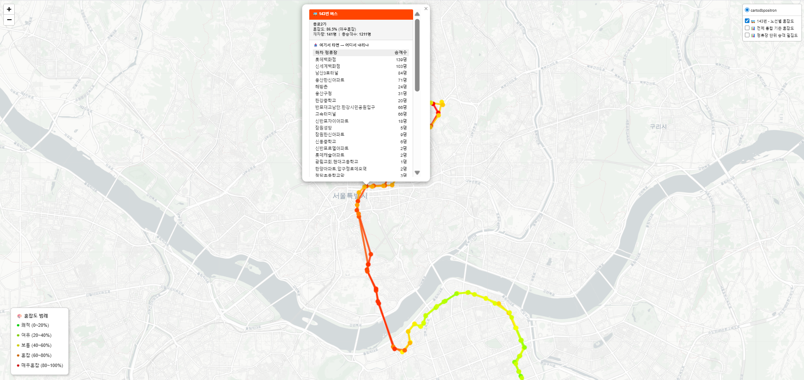
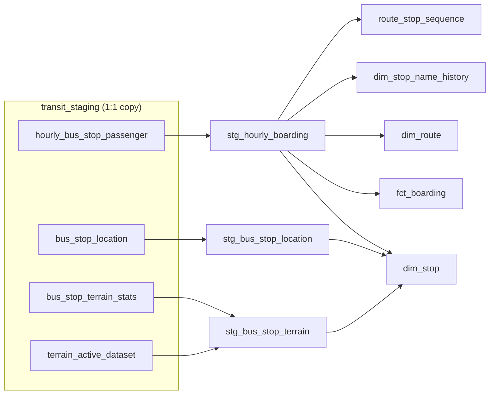
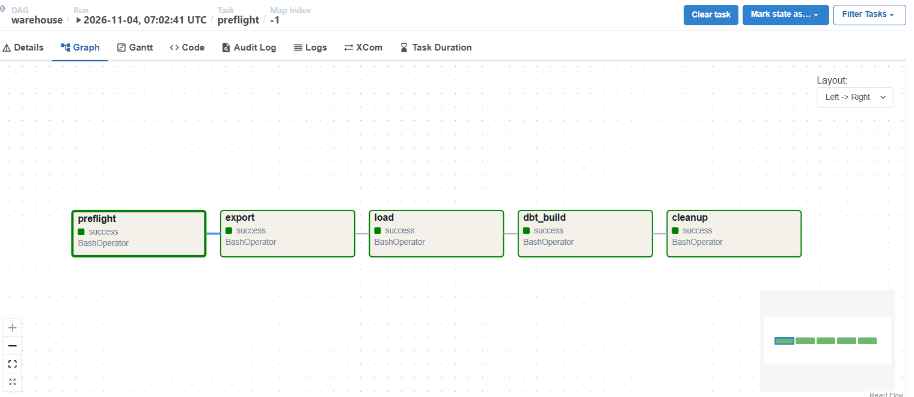

# SeoulTransitPlatform

[](https://github.com/Ianx2933/SeoulTransitPlatform/actions/workflows/ci.yml)

SeoulTransitPlatform analyses public transit demand in the Seoul metropolitan
area at stop, station and district level, using the city's smart-card records.
It is the code behind **[CityRiderMap](https://cityridermap.com)**, which is not an
official Seoul Metropolitan Government service.
Each figure can be traced back to the source table and the method that produced
it.

Most of the work is in the data. About 10M transactions a day arrive with
missing route IDs, stop codes that disagree between tables, and incomplete
origin–destination records. The platform rebuilds OD flows from them, checks the
result, and serves spatial demand queries from it.

What a user can do on the site:

- **Route analysis**: riders on board along a bus route, where a stop's riders
  go, and the demand inside and across a chosen segment.
- **Riders on the road**: every route's riders placed on the road they ride,
  added up where routes share it, for a district, chosen routes, one stop or one
  segment (select link).
- **District OD**: where a 행정동's riders go and come from by rail and bus,
  which bus routes they board, and how far they travel.
- **Choose the days**: the representative day of the last twelve months
  (default), or any run of up to twelve months, and the boarding hours, on any
  day type. The page names the sample days behind every period figure.

**Findings so far:** a congested segment that supports a short-turn bus service,
a route segment whose demand would justify splitting it into a local service,
three routes that carry over half their demand on one core segment, and, once
terrain data was joined, a dong where 27 of its 29 bus stops stand on a grade of
8% or more. The service changes are proposals from the analysis; none has been
implemented. See
**[policy insights](docs/analysis/policy_insights.md)**. The OD days behind the
original analysis turned out to be inflated
([seventh defect](#inflated-od-days-and-the-java-correction)), so the OD-based
findings were recomputed on the representative weekday: the route 302 stop
pattern and the core-segment shares reproduce to within about two points (one
segment of route 4425 does not), while the route 143 segment is not the busiest
one on daily totals and waits for a peak-hour check. The recomputation adds how
much demand crosses each candidate truncation point and how far each stop's
riders travel. The terrain finding does not use OD.



## Live demo

**[cityridermap.com](https://cityridermap.com)** (also
[seoul-transit-prod.web.app](https://seoul-transit-prod.web.app)): the map client on
Firebase Hosting, calling the deployed API. It is in a closed beta with external
users; the public launch is planned for 2026-12-01.

One API instance is kept running, so there is no cold start. The database is a
`db-f1-micro` with 0.6 GB of memory, so the first request after a quiet period can
still wait while it reads from disk (the heaviest district view took 28 s on
2026-11-20); later requests are in the ranges below. See
[Serving under load](#serving-under-load).

## Highlights

| | |
|---|---|
| **Data validation** | Reconciliation checks found a loader overwrite understating monthly boarding by 3.6% and holiday-table errors in six months; fixed, rebuilt on 32 months, and now asserted by tests that surfaced two further holiday omissions ([details](#data-quality-and-validation)) |
| **Data correction** | Four-stage OD identifier recovery plus a separate three-stage coordinate matcher with per-row method/confidence provenance. The Java OD correction was ported to pandas and matched row for row against its own SQL on three real days (1.48M rows); the port then fixes a merge defect that added 675–1,550 passengers a day and cleared 15,000–20,000 stop codes ([details](#inflated-od-days-and-the-java-correction)) |
| **Representative OD** | Twelve months of corrected days averaged per day type in BigQuery and scored by leaving each day out: on weekdays the error is 5.6% by stop, 3.3% by route and 25.6% by OD pair. Loaded into Cloud SQL, it serves every OD view by default ([details](#representative-od)) |
| **Months and hours** | Any run of up to twelve months is averaged on request in BigQuery by the same rule as the representative day, and any boarding hours on any day type are split from it at request time. A period equal to the representative window gives the same figures (0.00% difference), and 0–23 h gives the day back ([details](#choosing-months-and-hours)) |
| **Hourly split, checked** | Hourly OD assumes a stop's riders share one time profile whatever their destination. Rebuilding hourly alightings from it and comparing with counted ones gives 7.6% WAPE by route and hour against 6.9% for boardings checked the same way ([details](#what-the-hourly-od-is)) |
| **Bus riders on the road** | Each OD leg is placed on the stop-to-stop segments of its route's stored path (Seoul bus route API), and routes sharing a road are added up: a district's riders by road, chosen routes together, one stop, or everyone who passes one segment (select link). Checked automatically against the route chart on 8 routes; the check found three defects, now fixed, and every route agrees to within 4.4 riders a segment. A district's view went from a 5.2 s median to about 0.4 s, mainly from two missing indexes ([details](#bus-riders-on-the-road)) |
| **OD collection** | A Cloud Run Job copies TOPIS's monthly OD archives to Cloud Storage unchanged, with a SHA-256 manifest written last as the completion marker; 34 months stored. A second Job corrects every stored day (102) and the warehouse loads them into BigQuery, checked against each day's report |
| **Spatial stack** | PostGIS with GIST, composite, and expression indexes over 1,208 administrative boundaries |
| **Query performance** | District-demand endpoint reduced from ~9.5–12.9 s to sub-second cold calls (best observed 192 ms) with spatial, composite, and expression indexes ([details](#performance-district-demand)) |
| **Raster integration** | Terrain attributes from a Copernicus GLO-30 DEM published as immutable versioned snapshots, served per stop and per dong |
| **Demand profiling** | 34 months of hourly boarding read from the warehouse as a labelled 3-D array (34 × 24 × 12,850) and grouped by terrain band, reconciled to the passenger against the source copy |
| **Analytical warehouse** | BigQuery models built with dbt from a 1:1 staging copy: 34 months of hourly boarding (31.7M rows), 102 corrected OD days, district OD for every day; 28 models and over 50 tests, including per-month reconciliation to the source. Serving stays in PostGIS; only the months-and-hours views read BigQuery ([details](#analytical-warehouse-bigquery-and-dbt)) |
| **Open data** | The tables behind the site, published weekly as gzip CSV in a public bucket and as a BigQuery dataset, with a manifest of rows, columns and attribution written last; a release is rewritten only when its rows change ([details](#open-data)) |
| **Serving on a small database** | A load test found the limit in database memory, not in the API: raising the connection pool or the instance count did not help, a larger tier did. The service stays on `db-f1-micro` with precomputed lookups, in-memory caches and a CDN-cached route list ([details](#serving-under-load)) |
| **Cloud pipeline** | Weekly Cloud Scheduler → Workflows → 10 Cloud Run Jobs: loads any newly published month, rebuilds the hourly models into shadow tables, validates them, swaps them in in one transaction and publishes to BigQuery. A full rebuild went from 9 h 30 min to 1 h 31 min with an identical output hash; failed runs send an alert ([details](#weekly-cloud-pipeline)) |
| **Orchestration** | Airflow DAG runs a preflight check, export, load and `dbt build` in order; each step is safe to retry, and the export is deleted only after the tests pass ([details](#orchestration)) |
| **Backups** | Weekly Cloud SQL export to Cloud Storage, outside the instance, with 60-day retention. The first export was restored end to end in 22 minutes and matched the warehouse copy row for row ([details](#backups)) |
| **Reproducibility** | Schema scripts + Docker Compose; automated tests use synthetic fixtures; model binaries excluded by design |

## Data quality and validation

Extending the hourly boarding table from six months (2025-01 to 2025-06) to
thirty-two (2024-01 to 2026-08) turned up four defects. All of them produced
plausible numbers and none raised an error. Each was found by checking a figure
against something the pipeline had not produced itself.

- **Loader overwrite.** The source API returns one row per stop *visit*; a route
  passing the same stop twice collided on the table key and the upsert kept only
  one row. 2024-01 boarding was understated by 4,518,304 (3.6%), with row counts
  unaffected. The loader now sums a whole month before writing.
- **Wrong holiday dates.** Day-type counts per month were checked against the
  calendar; six months failed. The calendar is now asserted by tests, which then
  found two further omissions.
- **Fallback ratio summing to 1.105.** Every fallback estimate was inflated by
  10.5%. It is now normalised.
- **All-zero fitted profiles.** 2,327 of 283,353 ratio keys summed to zero, so
  18,965 daily OD passengers on 2025-11-11 reached no hour. Profile selection now
  has three levels, and each row records which one applied.

| Check after rebuild | 32 months, local (Oct 2026) | 34 months, Cloud SQL (Nov 2026) |
|---|---|---|
| Re-loaded months: row counts against the loader log | 24 of 24 match | — |
| Hourly ratio keys summing to exactly 1 or 0 | 283,353 of 283,353 | 285,201 of 285,201 |
| Non-numeric or `00000` ARS codes in derived tables | 0 | 0 |
| Duplicate OD-hour rows across estimation methods | 0 | 0 |
| OD keys in the estimate against the source | 514,499; 0 missing, 0 extra | 514,499; 0 missing, 0 extra |
| Hours per OD key | 24 distinct, no exceptions | 24 distinct, no exceptions |
| Daily passengers conserved per OD key | 0 mismatches at 1e-07 | 0 mismatches at 1e-07 |
| Daily OD passengers not distributed to hours | 0 of 5,345,649 | 0 of 5,345,649 |
| Fallback-profile rows, 2025-11-11 | 243,960 (181,272 with no key, 62,688 fitted to zeros) | 204,888 (181,272 with no key, 23,616 fitted to zeros) |
| SHA-256 over every hourly OD row, across re-runs | identical | identical over the manual rebuild and three workflow runs |

Totals are compared per OD key as well as in aggregate, because errors in
opposite directions can cancel out in a 5.3-million sum. `validate_rebuild.py`
runs all the checks and exits non-zero if any of them fails, so a rebuild that
reports success with wrong data stops there.

A fifth defect was found in November 2026, in OD correction rather than the
hourly pipeline. Missing standard stop codes were filled from the T-data stop
API, which ignores its filter and returns the first 1,000 stops of the whole
master. The client took the first item as the answer, so every successful
lookup returned the same Incheon stop (`164000626`), one no Seoul route serves.
Runs on 2023-10-17, 2024-10-19 and 2025-10-14 wrote it into 396 rows: 256
boarding and 144 alighting codes. For later runs the stored key no longer
matched, the API answered 404, and correction fixed nothing without reporting it. The rows
were copied aside, cleared and refilled from the local stop master, whose node
ID matches the source's standard ID for 10,685 of 10,686 stops. The deployed
Cloud SQL database had been migrated from the local one with the same 396 rows,
so the curated OD API could serve the Incheon code for them until both were
cleaned the same way on 2026-11-04. Correction now uses that table instead of
the API, and a test checks that different stops get different codes.

A sixth defect sat in the same table and was larger. About 1–2% of rows had a
standard code that belonged to a different stop than their ARS number: 0.8% on
2023-10-17 and 2024-10-19, 1.7% on 2025-10-14 and 2.0% on 2025-11-11, the OD
estimation day. OD correction took codes from a reference file by route and
position on the route, without checking that the stop at that position was the
same. On routes that had gained or lost stops since the reference was made,
every later stop took the code of a neighbour a fixed number of places along.
On 2025-10-14, 75% of the wrong codes belonged to another stop on the same route
that day, most often two places along (17 routes) or four (8 routes). The same
wrong route, position and code combinations recur on all four dates, which is
what one reference applied to every date would produce. Correction now looks up
codes in the stop master by ARS first, uses the reference only where the ARS
at that position matches, fills by stop name only rows with no ARS, and fails
if any code disagrees with the master. A test rebuilds a route with one stop
inserted; the old code gives the next stop its neighbour's code and fails it.
In both databases 117,110 rows were copied aside and 71,071 boarding and
85,323 alighting codes rewritten from the master.

The stops that check could not reach held two more cases. Stops outside Seoul are
missing from the Seoul master but present in `integrated_bus_stop_location`;
950,326 of their rows matched it and 2,851 codes were rewritten from it. ARS
`00000` marks a stop with no ARS number, such as a depot. The same-ARS fill
treated it as one stop and copied one depot's code onto about ten others, so
those 10,440 codes were cleared rather than guessed, and correction now treats an
all-zero ARS as missing. The diagnostic and fix queries for these defects are in
[`database/data_fixes/`](database/data_fixes/).

**[The hourly pipeline rebuild](docs/analysis/hourly_pipeline_rebuild.md)**
describes how each defect was found, confirmed and fixed, including the
virtual-stop filter and the move from an underdetermined to an overdetermined
ratio model.

### Inflated OD days and the Java correction

A seventh defect was in the OD days themselves. Three of the four corrected days
in `analysis_table_final` hold several times the passengers a day can have:

| Date | Rows | Distinct OD keys | Passengers | Regenerated from TOPIS |
|---|---|---|---|---|
| 2023-10-17 (Tue) | 2,392,432 | 489,818 | 73,958,020 | 5,055,834 |
| 2024-10-19 (Sat) | 1,930,124 | 479,007 | 16,764,916 | 4,119,456 |
| 2025-10-14 (Tue) | 1,979,512 | 494,863 | 21,266,216 | 5,316,816 |
| 2025-11-11 (Tue) | 516,678 | 516,667 | 5,351,327 | 5,351,327 |

The last column is the same day corrected again from the TOPIS original with the
`fixed` port (below).

There are about four rows per key on all three days (4.0, 4.0 and 4.9), and the
repeats are identical rows, which points to the corrected file being loaded more
than once. That accounts for roughly 4× on two days but not 14× on 2023-10-17. The local and Cloud SQL tables are identical.
The BigQuery warehouse, the xarray profile and the hourly OD allocation (which
uses 2025-11-11) do not read the three days, and the map client does not call
the curated OD endpoints, but those endpoints are public and return these rows.
The rows were not patched in place: the days were regenerated from the TOPIS
originals (below), the endpoints now read the representative OD, and the old
table is kept as `analysis_table_final_legacy`.

Porting the Java OD correction (the API server's `odcorrection` package, removed
in November 2026 once the port ran as a Job; its SQL is kept in
`pipelines/od_correction/sql/` as the baseline) to pandas found a second source of inflation, in the correction itself. Each of its
three groups of fixes (virtual stops, stop sequences, same-stop trips) ends with
`deduplicateAndSum`, which merges rows that now share a key. It has four defects:

- The boarding standard code is neither grouped on nor written back, so every
  merged row loses it.
- Rows are grouped including stop names, but deleted by key alone, so a row with
  the same key and a different name is deleted without being added in.
- The delete compares keys with `=`, which never matches `NULL`. Rows with no
  route ID or sequence stay, and their sum is inserted as well. Because the merge
  runs three times and each pass sums the copies the previous one added, two such
  rows of 3 and 4 passengers end as 3, 4, 7, 14 and 28: eight times the original.
  This is a candidate for the 2023-10-17 excess, not yet confirmed.
- The early exit counts duplicates on eight columns and merges on nine.

The port was checked before any of this was fixed. The original SQL runs
statement for statement on session temp tables (`run_java_baseline.py`), the
same input goes through the port in `faithful` mode, and the two outputs are
compared as row multisets. Two places where PostgreSQL itself was not
deterministic (a tie in a mode, and an `UPDATE ... FROM` matching several rows)
get documented tie breaks in both. The `fixed` mode then merges on the OD key,
NULL-safely, and stops if passengers in differ from passengers out plus the
anomaly table on any route. On the three days of the September 2026 archive:

| | 2026-09-15 (Tue) | 2026-09-19 (Sat) | 2026-09-20 (Sun) |
|---|---|---|---|
| Source rows / passengers | 527,159 / 5,586,785 | 491,797 / 4,513,103 | 460,227 / 3,517,113 |
| Java SQL against `faithful`: rows and all 19 step counts | identical | identical | identical |
| Passengers added by the Java correction | +1,550 on 12 routes | +950 on 8 routes | +675 on 9 routes |
| Boarding standard codes empty, before → Java | 1,892 → 22,051 | 1,663 → 19,557 | 1,519 → 16,920 |
| Boarding standard codes empty, before → `fixed` | 1,892 → 1,794 | 1,663 → 1,565 | 1,519 → 1,429 |
| `fixed`: passengers out + anomaly − in | 0 | 0 | 0 |

A day loaded once, such as 2025-11-11, could have carried a small excess of this
order. Regenerated, it has the same daily total as the table, 5,351,327. 150 random tables
are also run through both paths in the test suite whenever a PostgreSQL server
is configured.

### Regenerating the OD days

TOPIS publishes one archive a month, around the 10th of the next month: route-level
stop OD for three days, plus daily district and subway OD. Which days varies:
2026-09 has a Tuesday, a Saturday and a Sunday, 2024-10 a Saturday, a Wednesday and
a Thursday. Day type is therefore read from each date. `pipelines/od_stacking/collect_topis_od.py` runs as
the Cloud Run Job `transit-od-collect`. It copies every archive from 2024-01 onward
that Cloud Storage does not hold yet, byte for byte, and writes a manifest beside it
with the SHA-256, the member list with CRCs and the OD days found. The manifest is
written last, so a month with an archive and no manifest is treated as an
interrupted upload and fetched again. Keeping the originals means a correction
defect can be fixed and re-run without asking the source again. 2024-01 to 2026-09
and 2023-10, which holds 2023-10-17, are stored.

The Cloud Run Job `transit-od-correct` then corrects each stored day: standard codes
(`od_correction_pipeline.py`), the Han River ferry rules (`ferry_od.py`), and
structural correction (`fixed`), which stops the day if passengers out plus the
anomaly table differ from passengers in. It writes the result, the anomaly rows and a
report to Cloud Storage, the report last. All 102 stored days have been corrected.
The warehouse loads each day into its own BigQuery partition and checks rows,
passengers and the date in every row against the report; dbt builds `fct_od_stop`
from there, with a day type per date and a seed of days that must not count as
ordinary (the bus strike of 2026-01-13, Seollal, ferry suspensions).

That date check found one more defect. Correction parsed `기준일자` only in the
`YY/MM/DD` form, and some months of the archive use another one, so 21 days came
out with the date empty and the right totals. The parser now reads every form found
and stops on a value it cannot read; the days were corrected again.

### Representative OD

One TOPIS day is a sample, and a day type averages out what a single day cannot.
dbt builds `fct_od_typical` from the last twelve months of corrected days, by day
type (weekday, Saturday, Sunday and public holiday), mode, route and stop pair,
with a pair absent on a day counted as zero. Special days stay out: the bus strike,
Seollal and Chuseok, ferry suspensions.

`od_typical_accuracy` scores it by predicting each day from the other days of its
type and comparing with what happened (WAPE, also after scaling the prediction to
that day's total):

| Level | Weekday | Saturday | Sunday / holiday |
|---|---|---|---|
| Stop | 5.6% | 7.6% | 7.9% |
| Route | 3.3% | 4.2% | 4.2% |
| OD pair | 25.6% | — | — |

Six months scored about the same as twelve, and twenty-four months scored worse
(weekday route 4.4%), so the window stays at twelve. OD pairs stay noisy because
most pairs carry a few passengers a day.

The serving copy (`od_typical_route_stop_serving`) is exported from BigQuery to
Cloud Storage with a manifest written last. The Cloud Run Job
`transit-od-typical-load` checks the manifest, copies the rows into
`od_typical_route_stop__next`, checks rows and passengers in the database and
swaps the table in. The weekday holds 728,176 rows and 5,415,129 passengers a day.
The hourly allocation then runs on it (`--source typical`) and the full
validation passed: 726,099 OD keys, 5,409,012.5 passengers conserved, 17.42M
hourly rows. `analysis_table_final`, with the inflated days, was renamed
`analysis_table_final_legacy` once nothing serving read it.

### What the hourly OD is

Hourly OD is computed by allocation. Two separate sources meet in it: the OD
records give origin, destination and passengers for a whole day with no time of
travel, and the hourly boarding counts give, for each stop and hour, how many
people boarded over 34 months, but not where they went. Each daily OD pair is
spread over 24 hours in proportion to the day-type hourly boarding profile of its
route at its boarding stop. That assumes every pair leaving a stop shares the
stop's profile; in practice a stop's morning riders and evening riders head to
different places. The checks above prove the allocation is complete and conserves
every passenger. Since November 2026 the split is made at request time for any day
type and any months ([Choosing months and hours](#choosing-months-and-hours)),
with the rules of the batch allocation.

**Alighting reproduction.** Boardings by hour match by construction, so the test is
the other end. Every allocated rider is moved forward by the ride (stops ridden ×
1.5 minutes) and the resulting hourly alightings are compared with the counted ones,
over the twelve months of the representative window, 658 routes, each route (or
route and stop) scaled to its counted total first:

| WAPE | route × hour | stop × hour |
|---|---|---|
| Boardings (control) | 6.9% | 17.3% |
| Alightings | 7.6% | 21.7% |

The boarding control is not zero because the profiles are solved over 34 months
and per day type while the counts mix all days of one year. Over that floor the
destination-independent split adds about 0.7 points by route and 4.4 by stop. The
routes with the largest errors are off by as much on the boarding control, so their
profiles, not the split, are what to fix first. Method, ride-time variants and
reading: [`docs/analysis/alight_reproduction.md`](docs/analysis/alight_reproduction.md).

## Bus riders on the road

The route chart shows riders on board along one route. The road view puts every
route's riders on the road itself, so a corridor served by twelve routes shows
its total. Each representative-OD leg (route, boarding stop, alighting stop,
riders) is placed on the route's stored path: `bus_route_path_*`, cut into
stop-to-stop segments from the Seoul bus route API and refreshed weekly by the
`transit-bus-route-path` Job. Segments with the same two stops are summed across
routes and keep each route's share.

| View | Endpoint | Median response |
|---|---|---|
| A district's riders (boarding, alighting or both, a trip inside counted once) | `GET /api/dong-od/{code}/route-load` | 0.39 s (5.19 s before 2026-11-19) |
| Chosen routes added up (up to 20) | `GET /api/road-load/routes` | 1.00 s |
| One stop's riders on every route | `GET /api/road-load/stop` | 0.51 s |
| Everyone who passes one segment, with where they come from and go to (select link) | `GET /api/road-load/segment` | 0.92 s |

Medians of three calls to the deployed service on 2026-11-18; the district row
after the 2026-11-19 fix is the median of three calls on 2026-11-20 (API run
locally against the production database). The district query was slow on the legs
of its stops: `od_typical_route_stop` had no index on the boarding or alighting
stop; two (`기준일자` with each) were the main fix. A first call after a quiet period
waits for the Cloud Run cold start.

**Checked against the route chart.** For one route the road view and the route
chart count the same riders, so they must agree segment by segment.
`ops/checks/quality_checks.py` compares them on eight routes. The first run did
not agree on four, and each difference had its own cause:

| Cause | Symptom | Fix |
|---|---|---|
| A stop served twice (6411 passes 17104 on a loop) | 390 riders a day short on 92 segments of 6411, 50 on 48 of 302 | Legs carry TOPIS's stop sequence, and a stop that occurs twice on a path is matched by it |
| TOPIS's virtual depot stop (ARS `00000`, sequence 0) | 448 riders a day of 143 had no place on the path | They ride from the first stored stop |
| An ARS number now used by another stop (05170 is 복정파출소 on 302 and 452, but 어린이대공원역 in the stop table) | Riders put in the wrong district | `stop_location_fix` overrides both stop tables for 111 ARS |

After the fixes:

| Route | Segments compared | Riders matched | Largest difference | Riders not placed |
|---|---|---|---|---|
| 143 | 112 | 99.8% | 0.3 | 14.4 |
| 302 | 123 | 97.9% | 0.7 | 1.8 |
| 452 | 126 | 100.0% | 0.0 | 3.4 |
| 470 | 82 | 96.2% | 1.9 | 12.7 |
| 6411 | 114 | 100.0% | 4.4 | 5.4 |
| 7016 | 103 | 97.3% | 0.6 | 5.9 |
| 2312 | 104 | 100.0% | 1.1 | 0.8 |
| 1711 | 63 | 99.9% | 0.5 | 6.1 |

Riders not placed boarded or alighted at a stop the route no longer serves.
`ops/stop_coords/check_stop_coords.sql` compares every stop's position in the
stop tables with its position on the stored paths; 101 ARS on the paths were in
neither table, and 12 stops with the same name more than 1 km apart are listed
for a manual decision (Known gap 12).

## Choosing months and hours

By default every OD view reads the representative day from Cloud SQL. A user can
instead pick a run of whole months (up to twelve) and boarding hours (one hour or a
range, stepped with ◀ ▶). Those views read BigQuery:

| | Months | Hours |
|---|---|---|
| Route OD | `fct_od_stop`: the days of the period and day type, sum per stop pair ÷ days, a pair absent on a day counted as zero (the rule of `fct_od_typical`) | Legs × the boarding stop's profile (`hourly_profile`, same rules as the batch allocation), any day type |
| District OD | `fct_od_dong_month` ÷ `od_dong_period_days` | Whole days only; the page says so |
| Sample | Route OD has about one day of each type a month, so the page lists the days ("3 sample days: 07-15 · 08-12 · 09-09") | — |

The API takes `period=2026-03..2026-05` and `hours=7-9` on the existing endpoints.
With hours, the road view also returns `legendMax`, the busiest segment of the
busiest single hour of the day, so the map can keep one colour scale while the
hours move.

**Checks** (`ops/checks/quality_checks.py`, 2026-11-20):

| Check | Result |
|---|---|
| Period = the representative window (2025-10..2026-09), 3 routes and one district's OD | identical, 0.00% |
| 0–23 h = the whole day, Saturday, 3 routes | 0.00%, except route 143 at −1.10%, most likely riders from the virtual depot (ARS `00000`), which the split leaves out as the batch allocation does |
| One hour, route chart against road view | identical |
| Response, 12-month period | route 1.1 s, district OD 0.6 s, district road view 2.4 s |

**Cost.** BigQuery checks the bytes-billed cap against its upper estimate, which
ignores clustering, and on these tables bills that estimate too: 0.9–1.2 GB for a
route over twelve months, 1.8 GB each way for a district's road view. The cap is
3 GB a query, the API's service account has a daily quota of 0.2 TiB, and each
answer is cached. If BigQuery fails, the views answer 503 and the page offers the
representative day, which does not use it.

## Open data

The download page (`#/download`) offers five tables as gzip CSV, UTF-8 with a header
row, from the public bucket `gs://seoul-transit-open-data`. The same tables are in the
BigQuery dataset `transit_open`.

| File | Contents | Rows (release 20260920) |
|---|---|---|
| `route_stop_od_typical` | Representative-day route stop OD, three day types | 2,171,908 |
| `district_od_typical` | Representative-day 행정동 OD by rail and bus | 244,382 |
| `stop_hourly_profile` | Share of a day's boardings in each hour, by route, stop and day type | 2,933,496 |
| `stops` | Stop key, name and WGS84 position | 12,850 |
| `typical_accuracy` | Leave-one-day-out WAPE of the representative day | 256 |

`od/open_data_export.py` in transit-bigquery runs at the end of the weekly warehouse
step. It writes each table to `transit_open`, extracts it and joins the shards behind a
gzip header into one file per table under `releases/<window end>/`, writes
`manifest.json` last and copies the release to `latest/`. Links on the page point at
the release folder, so a cited link keeps naming the same file. When the rows are the
same it leaves the files alone, and when only the text changed (attribution,
descriptions) it rewrites the manifest alone. A failure there is reported without
failing the weekly run, so the public files never hold up the serving loads.

The bucket is readable by anyone and writable only by the warehouse job's service
account; CORS lets the site read the manifest. Source data are KOGL Type 1
(공공누리 제1유형, attribution); the manifest and the page carry the attribution.

## Key capabilities

- Node-centered demand lookup around a coordinate radius.
- District-centered demand aggregation by administrative dong.
- Terrain screening by stop and by administrative dong, from published DEM
  snapshots.
- Bus and subway mode filtering.
- Weekday/day-type and hour filtering.
- Any run of up to twelve months and any boarding hours for the OD views, with the
  sample days shown.
- Route, node, and district-level demand summaries.
- Route analysis on the representative OD: load along the route, where a stop's
  riders go, demand inside and across a chosen segment.
- District OD by rail and bus for a 행정동, its 구, Seoul, or districts picked on
  the map together: where riders go, where they come from, bus routes boarding
  there, riders on the road, and how far they travel (straight line between
  districts, in distance bands).

## Deployed architecture

Everything runs in `asia-northeast3` (Seoul).

```text
Firebase Hosting ──rewrite /api/**──> Cloud Run: transit-api (public)
  static Vite build                     │
                                        ├──months and hours (read only)──> BigQuery: transit_marts
                                        ├──unix socket──> Cloud SQL: PostgreSQL 18 + PostGIS
                                        │                   ▲
                                        │                   │ unix socket
                                        │                   │
                                        │   Cloud Scheduler ──> Workflows: transit-pipeline
                                        │     weekly                 ├─> Cloud Run Job: collector ──> Seoul Open API
                                        │                            ├─> od-collect ──> TOPIS ──> Cloud Storage
                                        │                            ├─> od-correct (new OD month) ──> Cloud Storage
                                        │                            ├─> bus-route-path ──> Seoul bus route API
                                        │                            ├─> 8 rebuild, validate, publish Jobs (new month only)
                                        │                            ├─> Cloud Run Job: warehouse ──> BigQuery + dbt ──> open data (public bucket)
                                        │                            └─> od-typical-load, od-dong-load <── Cloud Storage <── BigQuery
                                        │   Cloud Scheduler ──> Workflows: transit-db-export ──> Cloud SQL export ──> Cloud Storage
                                        │     weekly
                                        │
                                        └──ID token─────> Cloud Run: transit-prediction (private)
```

### Design decisions

**No Memorystore.** The application defaults to Redis, but the deployed service
runs Caffeine (`CACHE_TYPE=caffeine`). Memorystore's smallest instance costs
roughly three times the database, which is the wrong trade for a demo whose
only fixed cost is a `db-f1-micro`. Each Cloud Run instance then holds its own
cache; acceptable at this traffic, and the cache provider is a single
environment variable away from changing.

**The prediction service is not public.** It is deployed with
`--no-allow-unauthenticated`, and `transit-api` attaches a Google-signed ID
token whose audience is the service URL. Every inference call costs money, so
knowing the URL should not be enough to make one.

**No CORS configuration on the API.** Firebase Hosting rewrites `/api/**` to the Cloud
Run service, so the browser only ever sees one origin. The frontend calls relative
paths and needs no build-time API URL. The only CORS rule is on the public open data
bucket, which the download page reads directly (`ops/open_data/cors.json`).

**Cloud SQL is the source of record, and is sized for serving.** The hourly
table (34 months, 31.7M rows), the OD tables and every model built from them
live in Cloud SQL, and the local database is a development copy. The instance
idles as a `db-f1-micro`. On it the ratio solver needed 7–20 minutes per batch of
50 routes and ran out of memory, so the workflow raises the tier to
`db-custom-2-7680` for the rebuild and lowers it again afterwards, including when
a step fails. The batch tier is billed only for the hours of a rebuild, which
happens when a new month is published.

**Rebuilt tables replace the old ones instead of updating them.** The first cloud
rebuilds upserted into the tables the API reads. That had two costs. The API
served rebuilt figures before validation had run, so a failed check came too late.
And PostgreSQL keeps the old row versions until vacuum frees the space for reuse,
so each table ended up about twice its size: `estimated_hourly_stop_demand` was
1,985 MB in Cloud SQL against 990 MB locally for the same rows, the steps that read
it whole slowed down run after run, and the disk grew by auto-resize from 10 GB to
37 GB, which Cloud SQL cannot shrink. Each rebuilt table is now written from empty
to a `__next` copy, validated there, and swapped in by renaming. The database went
from 20 GB to 16 GB on the first such run, and the disk now has a 45 GB
auto-increase cap so that any further growth fails a run and raises an alert
instead of going unnoticed.

**Browser-facing API without a hosted basemap key.** The map originally used
CartoDB Positron, whose CDN began returning watermark tiles for
unauthenticated requests. The client moved to OpenStreetMap rather than
embedding a CARTO key in a public static bundle.

**Workflows rather than managed Airflow.** The cloud pipeline is ten steps in a
fixed order with one branch (stop if no new month) and one cleanup (scale the
database down). Cloud Workflows covers that and costs next to nothing at one run a week;
Cloud Composer, the managed Airflow option, starts around thirty times the
monthly cost of the database it would be feeding. Airflow stays for local
development, where the DAGs run against the local copy.

**The collector works out which months to load.** Cloud Scheduler sends no
arguments. Called without any, the loader starts after the latest month already
in Cloud SQL and loads each published month up to last month, stopping at the
first one the API reports as not published yet. Publication dates vary (August
2026 data appeared on 3 September, October data was still missing on 4
November), so running weekly and loading whatever has appeared is simpler than
guessing a monthly date. The loader writes the months it loaded to a state file,
and the workflow rebuilds only when that list is not empty.

Deployment environment variables and cache profiles are described in
[`docs/deployment/configuration.md`](docs/deployment/configuration.md).

## Terrain and demand analysis

Bus stop demand is served alongside terrain attributes derived from a Copernicus
GLO-30 DEM by the companion project
[geo-raster-pipeline](https://github.com/Ianx2933/geo-raster-pipeline).

```text
GET /api/stops/accessibility?minSlope=8&limit=100&offset=0
GET /api/stops/accessibility/summary?minSlope=8&minStops=10
GET /api/stops/accessibility/metadata
```

The first returns individual stops at or above a slope threshold, steepest
first. The second aggregates by administrative dong, worst ratio first. The
third reports which snapshot is active and how it was produced.

**Result.** Of 11,480 stops, 4,536 (39.5%) sit on terrain at or above an 8%
grade; the median is 6.51%. Dongs differ widely: Seonghyeon-dong (성현동)
tops the list with 27 of 29 stops (93.1%), while riverside dongs sit
near zero.

### Terrain is stored as versioned snapshots

Terrain values are not stored on `bus_stop_location`. That table is periodically
reloaded from source CSV, and the next reload would wipe a derived column
without any error. The API would keep returning 200 with the values gone.

Instead each processing run is published as an immutable snapshot
(`terrain_dataset`, `bus_stop_terrain_stats`, `terrain_stop_dong_assignment`,
and a single-row `terrain_active_dataset` pointer). Publication and activation
are separate steps, so a partially loaded snapshot is never visible, and the
dong-summary cache is keyed by dataset ID with no explicit invalidation.

The stop-to-dong assignment is resolved **once at publication**, not per query.
`ST_Covers` matches a point lying on the shared edge of two polygons, so a
boundary stop would otherwise appear in both dongs and inflate every aggregate.
Interior matches win; remaining ties break deterministically on `adm_cd`; a stop
found strictly inside two polygons aborts the publication, because that means
the boundary layer itself overlaps.

Publishing and activating a snapshot:
[`docs/terrain/publishing.md`](docs/terrain/publishing.md).

### What the numbers mean

This measures terrain gradient across the 30 m DEM cell containing each stop.
It is **not** footway gradient and **not** an accessibility assessment. The
source is a surface model that includes buildings, which inflates values in
dense districts; conversely, 30 m resolution averages away short steep pitches.
Treat it as a screening indicator for narrowing down where to survey.

### An hourly profile in xarray

The boarding source is already three-dimensional (month, hour, stop), so
`pipelines/analysis/demand_xarray.py` loads it as a labelled array rather than a
flat frame, attaches slope as a non-dimension coordinate on the stop axis, and
groups by terrain band. The array total is asserted against the source before
anything is read from it.

It reads from the BigQuery warehouse (`--source bigquery`): demand from
`fct_boarding`, slope from `dim_stop`, and the reconciliation total from the
staging copy of the source, so the check does not read the table it checks.
Reading the serving database instead took hours on its idle tier and lost the
connection from the workstation twice, which is the split the warehouse exists
for. The PostgreSQL path remains, one month per query.

10.15M source rows expand to 34 × 24 × 12,850 cells. Many cells are empty: a stop
with no service at 03:00 has no observation, which is different from zero, so every
aggregate uses `skipna`. Of
the 12,850 stops, 2,050 have no terrain value, nearly all of them Gyeonggi-do stops
outside the Seoul stop master; they stay in the array and the totals but in no band.

**Result.** Mean boardings per stop-hour, 2024-01 to 2026-10 (34 months, 4.81 billion
boardings reconciled), by slope band. Stops per band: 3,072 / 3,508 / 1,955 / 2,265.

| Hour | 0–4% | 4–8% | 8–12% | 12%+ | 12%+ as share of 0–4% |
| ---- | ---- | ---- | ----- | ---- | --------------------- |
| 04   | 90.5 | 84.6 | 71.2 | 43.0 | **48%** |
| 05   | 191.2 | 185.4 | 178.1 | 125.8 | 66% |
| 07   | 816.6 | 806.7 | 788.3 | 642.4 | 79% |
| 08   | 1014.0 | 1010.1 | 1015.7 | 802.0 | 79% |
| 18   | 1033.5 | 1055.4 | 1110.2 | 849.7 | 82% |
| 22   | 470.6 | 514.3 | 546.7 | 403.0 | 86% |

The steepest band carries roughly 79–86% of flat-ground demand through most of the
day. Between 04:00 and 06:00 that gap roughly doubles, reaching 48% at 04:00. In
the evening the 8–12% band exceeds flat ground outright, and its share of the daily
total peaks higher than any other band (0.084 against 0.080 at 18:00).

The first version of this table used six months loaded before the
[loader fix](#data-quality-and-validation) and left stops on 0% slope out of every
band. With the corrected data and five and a half times the months, every share moved
by one to five points and the shape did not change.

**This does not show that slope reduces ridership.** Slope is confounded with land use here:
steep districts in Seoul are largely residential and flat ground is largely
commercial, so a residential-versus-commercial hourly profile would produce a
similar shape with no terrain effect at all. Separating the two needs a land-use
control the platform does not have yet. The table is kept as a question to test
later, with the same caveat as the slope values themselves.

## Tech stack

| Layer | Technology |
|---|---|
| Backend API | Spring Boot, Java 21, Maven |
| Database | PostgreSQL, PostGIS |
| Cache | Redis (local), Caffeine (deployed) |
| Prediction service | Python, Flask, XGBoost |
| Frontend | React, Vite, Leaflet (OpenStreetMap basemap) |
| Pipelines | Python 3.14, Cloud Workflows, Airflow (local) |
| Multidimensional analysis | xarray, dask, netCDF |
| Raster processing | GDAL/OGR, rasterio (in [geo-raster-pipeline](https://github.com/Ianx2933/geo-raster-pipeline)) |
| Analytical warehouse | BigQuery, dbt (in [transit-bigquery](https://github.com/Ianx2933/transit-bigquery)) |
| Local infra | Docker Compose |
| Deployment | Cloud Run (services and jobs), Cloud SQL (PostgreSQL 18 + PostGIS), Cloud Scheduler, Cloud Monitoring, Artifact Registry, Secret Manager, Firebase Hosting |
| Testing | pytest, JUnit 5, Testcontainers/PostGIS, Vitest, GitHub Actions |

## Performance: district-demand

The district-demand endpoint was first measured at 12.9 s and 9.5 s on local
runs. Profiling identified two causes: spatial joins running without GIST
support, and identifier comparisons normalised with `LPAD` that no plain btree
index could serve.

Spatial, composite, and expression indexes plus refreshed table statistics
addressed both. After indexing, a measured call took 490 ms; with the cache
flushed, cold calls stayed under one second, with a best observed cold call of
about 192 ms. These were measured locally on one development machine, and 192 ms
is the single best call, not a median or p95.

Because the database path alone became sub-second, the deployed service does
not need a shared cache: it runs Caffeine instead of Redis (see *No
Memorystore*). Response times of the deployed service for the OD and road views
are in [Bus riders on the road](#bus-riders-on-the-road) and
[Choosing months and hours](#choosing-months-and-hours).

A precomputed node-to-district mapping table was considered and not built.
Indexing was enough, and the table would have needed rebuilding whenever stop
locations or boundaries changed.

The terrain integration made the opposite call and precomputed its stop-to-dong
assignment. The reason is not performance but correctness: a boundary stop
matching two polygons inflates every aggregate, and resolving that per query
would mean re-deriving the same tie-break on every request. Precomputation is
fine there because the assignment belongs to an immutable snapshot, and a new
boundary release means publishing a new snapshot anyway.

Index SQL: `database/performance/district_demand_indexes.sql`
Analysis: [`docs/performance/district_demand_optimization.md`](docs/performance/district_demand_optimization.md)

## Serving under load

Before the public launch, `ops/checks/load_test.py` sent the site's heaviest requests
with 1, 5, 10 and 20 simultaneous users, six requests each, against the deployed
service. Response times grew with users while the API and the database both had CPU
to spare: Cloud SQL peaked at 36.5% and Cloud Run at 10%. What spiked was disk reads.
`db-f1-micro` has 0.6 GB of memory, so most index and table pages are not cached and
each one missed costs a disk read of about 20 ms.

Raising the connection pool or the Cloud Run instance count only sent more queries to
the same disk. A larger tier did help, which confirmed the cause. Time for the
20-user stage:

| Tier | Memory | 20-user stage |
|---|---|---|
| `db-f1-micro` | 0.6 GB | 136.9 s |
| `db-g1-small` | 1.7 GB | 79.8 s (48.1 s on a second, warm run) |
| `db-custom-1-3840` | 3.75 GB | 41.2 s |

Expected traffic is small, so the instance stays on `db-f1-micro`. If traffic grows,
`db-g1-small` comes first, then `db-custom-1-3840`; the weekly workflow's final
scale-down tier changes with it. What was done to make the small tier enough:

- **Precomputed lookups.** Which stops lie in which 행정동, and each 행정동's point,
  were spatial joins on every request. They are now three materialized views
  (`stop_area_any`, `stop_area_primary`, `dong_point`) with indexes, refreshed after
  stop or boundary changes (`database/schema/10_stop_area_lookup.sql`); a check
  compared them with the old queries and found no difference.
- **Caches in the API.** Stop positions and road segment paths are kept in Caffeine
  for 12 hours and filled in bulk; the data changes once a week.
- **Route list on the CDN.** `/api/map/lines` ran a `DISTINCT` over the hourly demand
  table on every call, 6–8 s for a 6 KB answer. It is now cached in the API and sent
  with `Cache-Control: public, s-maxage=21600`, so Firebase Hosting serves it from
  its CDN (1 ms on a hit).
- **Settings.** One instance is kept running (`min-instances 1`), at most three, a
  pool of three connections each, and a 25 s statement timeout so a slow query fails
  instead of holding a connection.

## Analytical warehouse (BigQuery and dbt)

The serving API reads from PostgreSQL. Analysis runs on a separate BigQuery warehouse built
from the same data. The warehouse code is in [transit-bigquery](https://github.com/Ianx2933/transit-bigquery);
this section summarizes it.

- **Load:** a Python script copies 14 PostgreSQL tables 1:1 into a staging dataset. It writes
  checksums and per-month row and passenger totals at export, then recomputes the monthly
  totals in BigQuery after loading and stops if any month differs.
- **Transform:** dbt builds the models from staging: the boarding star schema
  below, the corrected OD days, the representative OD and its accuracy, district
  OD, and the period and hourly-profile models the months-and-hours views read.
  28 models, over 50 tests.
- **Data:** 34 months (2024-01 to 2026-10), 31.7M rows of hourly boarding by route and stop,
  exported from Cloud SQL by the [weekly cloud pipeline](#weekly-cloud-pipeline).



### What stayed in PostGIS

BigQuery is columnar and priced by bytes scanned. It has no equivalent of the sub-second
point lookups the serving path depends on, so the split follows the workload rather than the
tables:

| Stays in PostGIS | Moved to BigQuery |
|---|---|
| District-demand and node-catchment endpoints | Hourly boarding facts |
| `ST_Covers` against dong polygons at query time | Aggregations by route, stop and hour |
| GIST-indexed spatial predicates | Terrain statistics joined to stops |
| Anything with a latency target | Ad-hoc analysis |

### Modelling decisions

**No date dimension.** The source key is `(use_ym, route_no, stop_ars, hour)`: a monthly
aggregate by hour with no daily detail. A daily date dimension would suggest observations
that do not exist.

**Integer partitioning on the month.** The warehouse started in the BigQuery sandbox, where
partitions expire 60 days after the partition's own date. A day-partitioned table of 2025
data was empty right after loading, with the job reporting `DONE` and no error. Partitioning
on an integer `YYYYMM` avoids the rule and matches the monthly grain.

**Sandbox settings stay after billing is enabled.** Linking a billing account did not remove
the 60-day expiration already set on the datasets and on each table. By the time this was
checked, the staging tables had been deleted and the warehouse tables were seven days from
deletion. The expirations were cleared per dataset and per table, and staging was reloaded.

**Unmatched stops are kept.** 2,045 of 12,845 stops do not match the Seoul stop master:
2,044 Gyeonggi-do stops on routes that cross the city boundary, and one code (`~`) used for
route terminus markers. They stay in `dim_stop` with a `match_method` column so totals
reconcile against the source and analysts exclude them on purpose.

### Tests

`dbt build` runs the models and tests together. If a test fails, the build stops and the
production dataset is not updated. Builds run as the last step of the weekly cloud pipeline and
of the local `warehouse` Airflow DAG (below).

| Test | Fails when |
|---|---|
| Monthly reconciliation to staging | Any month's row count or passenger totals differ from the source copy |
| Unique fact grain | A (month, route, stop, hour) row appears twice |
| Stop count | `dim_stop` does not hold exactly the distinct stops in the source |
| Referential integrity | A route or stop in the fact table has no dimension row |
| Route type | A route name matches none of the classification rules |

The reconciliation compares totals by month and does not join to the stop table. An earlier
validation query that joined to stops counted some rows twice and overstated boardings by
127,070. At the 32-month reload of October 2026:

| | PostgreSQL | BigQuery |
|---|---|---|
| Rows | 29,855,640 | 29,855,640 |
| Boardings | 4,509,456,552 | 4,509,456,552 |
| Months | 32 | 32 |
| Distinct stops | 12,845 | 12,845 |

### What the modelling found

**Stop names.** Source stop names end with the stop's position on the route, for example
`동묘앞(00029)`. The same stop has a different number on each route that serves it, so 68%
of Seoul stops looked renamed over 32 months. With the number moved to its own column, 14%
(1,468 of 10,800) had real name changes, mostly exit numbers added or developments renamed.
An earlier six-month analysis had reported "1,815 Gyeonggi stops with 2,963 names" for the
same reason; the real figure is 156 of 2,044. Village and city buses also label some stops
differently (`서울숲1번출입구` on 성동13, `서울숲1번출구` on 121).

**Route types.** The 702 routes are classified from their numbers: village 260, branch 220,
trunk 134, commuter 31, custom 28, night 14, express 10, circular 2, autonomous 2, and the
Han River ferry. A trailing A or B marks a variant line of the same route. The source has no
Gyeonggi-registered routes; Gyeonggi stops come from Seoul routes that cross the city
boundary.

### Orchestration

The `warehouse` DAG in `pipelines/airflow/dags/` runs the whole path from the local
PostgreSQL database to the dbt models:



| Task | What it does | On failure |
|---|---|---|
| `preflight` | Connects to PostgreSQL and BigQuery and reports the months found | Stops in seconds instead of partway into an export |
| `export` | Read-only snapshot of 14 tables with checksums and per-month totals | Retried once; the retry deletes its own partial folder |
| `load` | Replaces the staging tables, then reconciles per month | Retried twice; tables already loaded are skipped, and a load job that reached BigQuery is not submitted again |
| `dbt_build` | `dbt build --target prod` | Not retried; a failing test leaves `transit_marts` as it was |
| `cleanup` | Deletes the export folder | Runs only after dbt succeeds, so a failed run's files stay for inspection |

The first full run took about ten minutes. Airflow runs locally in Docker on an image that
adds dbt and the BigQuery client in their own virtualenv, so they cannot change the versions
Airflow depends on. The PostgreSQL password is read inside the task at run time and does not
appear in the commands shown in the Airflow UI.

The DAG is triggered by hand and reads the local database. The scheduled path is the
[weekly cloud pipeline](#weekly-cloud-pipeline), which exports from Cloud SQL instead.

Getting the loader to run unattended meant three changes: it reads the password from the
environment instead of prompting, calls BigQuery through the Python client instead of the `bq`
CLI (which the container does not have), and can replace last month's staging tables instead
of refusing to overwrite them. Its offline tests went from 5 to 16 to cover retries, replace
mode and the missing-password case.

### Weekly cloud pipeline

`ops/workflows/transit_pipeline.yaml`, deployed with `ops/workflows/deploy.ps1`:

| Step | What it does |
|---|---|
| collect | Loads each newly published month and records which months it loaded |
| decide | Ends the run if nothing was loaded, about 20 seconds in total |
| scale up | Cloud SQL `db-f1-micro` → `db-custom-2-7680`, then waits until it accepts connections |
| rebuild | Month-day counts, day-type hourly ratios (route and stop level), OD allocation to hours, stop demand, bus + subway integration, each written to an empty `<table>__next` |
| validate | `validate_rebuild.py` on the `__next` copies; a failed check stops the run with the API and BigQuery unchanged |
| publish | Swaps all five copies in, in one transaction, and gives their indexes back the original names |
| warehouse | Exports from Cloud SQL, replaces the BigQuery staging tables, runs `dbt build --target prod`, then writes the [open data](#open-data) files |
| scale down | Back to `db-f1-micro`, also when any step fails |

A run that ends without success, and a trigger that fails to start one, each send an email
through Cloud Monitoring (`ops/monitoring/`).

**From 9 h 30 min to 1 h 31 min.** Every forced full rebuild produced the same SHA-256 over
all 12,347,976 hourly OD rows, so each change below was checked against the previous output
rather than only for speed.

| Step | 2026-11-07 | Read once | Shadow tables |
|---|---|---|---|
| Ratio solver | 3 h 15 min | 11 min 36 s | 7 min 24 s |
| Stop-pattern solver | 3 h 44 min | 13 min 54 s | 7 min 51 s |
| OD allocation | 39 min | 33 min | 3 min 3 s |
| Stop demand | 19 min | 29 min | 2 min 5 s |
| Bus + subway integration | 23 min | 43 min | 8 min 26 s |
| Validation | 17 min | 40 min | 16 min 51 s |
| Publish | — | — | 45 s |
| Warehouse | 43 min | 29 min | 24 min 53 s |
| **Whole run** | **9 h 30 min** | **3 h 42 min** | **1 h 31 min** |

*Read once.* The solvers queried the 31.7M-row hourly table once per batch of 25 routes, 29
times a run, and each query had to find its routes' rows scattered across every month. They
now stream the table in a few windows of 150 routes, ordered by route, and cut the same
batches from the stream; a check on real data compared both ways batch by batch and found
them identical. A single ordered read of the whole table failed first: its sort needed more
temporary disk than Cloud SQL allows one query (`temp_file_limit`, about 3 GB), so the
windows are sized to stay well under it, and a server limit error now stops the run instead
of being retried.

*Shadow tables.* Writing each rebuilt table from empty with `COPY`, instead of upserting
into a table already holding the previous rebuild, made the write-heavy steps five to ten
times faster, and kept the steps after them from slowing down as the tables bloated (the
middle column).

Steps run one at a time; with two write-heavy jobs at once, both ran several times slower.
Each solver batch commits on its own, and a dropped connection restarts the read at the
first batch not yet written. Timings by step and the prerequisites are in
[`ops/workflows/`](ops/workflows/README.md).

## Backups

In October 2026 the local PostgreSQL data directory disappeared. The cause was not found.
The database was restored from a single full dump that happened to exist from a few weeks
earlier, and the warehouse reload above was taken from that restore. A weekly `pg_dump` of
the local database (`ops/backup_pg.ps1`, Windows Task Scheduler) followed.

Once Cloud SQL became the source of record, that was the wrong database to back up: by
November the local copy was two months behind. Cloud SQL's automated backups (daily, with
seven days of point-in-time recovery) belong to the instance and would go with it, so a
second copy is now kept outside it:

1. Every Sunday a workflow (`ops/workflows/transit_db_export.yaml`) has Cloud SQL export
   the database as a compressed SQL dump to a private Cloud Storage bucket in
   `asia-northeast3`. The export runs on the instance rather than on a separately billed
   offload instance. It blocks other admin operations while it runs (41 minutes on
   `db-f1-micro`), so it is scheduled away from the Tuesday pipeline, which changes the
   tier, and from the nightly automated backup.
2. The run fails and sends an alert if the export fails or the file is smaller than
   500 MB.
3. A bucket lifecycle rule deletes objects after 60 days, which keeps about eight weekly
   copies.

The first export was restored into an empty local database with
`ops/restore_cloudsql_export.py`. The script streams the file from Cloud Storage through
gunzip into `psql`, so neither the compressed nor the plain dump is written to disk. The
restore took 22 minutes for 7.67 GB of SQL. Its only errors were two grants to roles that
exist only in Cloud SQL, and the hourly table matched the BigQuery copy exactly: 31,739,712
rows and 4,806,115,248 boardings, 2024-01 to 2026-10. The restored database replaced the
local one, which is now a development copy refreshed the same way, and the local backup
task is switched off. Cloud SQL exports leave out triggers and functions, so after a
restore the terrain guards are created again from `database/terrain/sql/01_terrain_schema.sql`
and `06_fix_terrain_guard.sql`.

## Status

| Area | Status |
|---|---|
| Map demand analysis (node-centered and district-centered) | Done |
| District-demand indexing and statistics refresh | Done |
| Terrain snapshots and stop/dong screening API | Done |
| Hourly pipeline rebuild, 2024-01 to 2026-10 | Done, validated; rebuilt in Cloud SQL |
| GCP deployment: serving path | Live at cityridermap.com, closed beta; public launch planned for 2026-12-01 |
| Load test and database sizing | Done 2026-11-22; stays on `db-f1-micro` ([Serving under load](#serving-under-load)) |
| Open data downloads | Live from 2026-11-23; first release 20260920 |
| Weekly cloud pipeline (collect, rebuild, validate, publish) | Running weekly since 2026-11-10; forced full runs passed on 2026-11-07 and 2026-11-08 (1 h 31 min); failure alerts tested |
| BigQuery warehouse | 34 months loaded and modelled in dbt; refreshed by the weekly pipeline |
| TOPIS OD archives | 2024-01 to 2026-09 and 2023-10 stored with manifests; checked by the weekly workflow, which corrects and loads a new month |
| OD correction port | Matches the Java SQL row for row on 2026-09-15, -19 and -20; runs as a cloud job, 102 days corrected with passengers conserved; loaded into BigQuery (`fct_od_stop`) |
| Day-type representative OD | Weekday, Saturday and Sunday/holiday built in BigQuery from 12 months, scored by leaving each day out and loaded into Cloud SQL; every day type can be split into hours on request |
| Months and hours | Checked on 2026-11-20; API deployed 2026-11-21, page 2026-11-24 |
| District OD by mode | TOPIS district OD averaged per day type in BigQuery, exported and loaded by the weekly workflow (`transit-od-dong-load`); served for a 행정동, 구, Seoul or a chosen group |
| Bus route paths and riders on the road | 672 stored paths for 666 TOPIS routes, refreshed weekly; road view checked against the route chart on 8 routes |
| Route analysis view | Live in the map client; months and hours from 2026-11-24 |
| Policy insights | Recomputed on the representative weekday (`pipelines/analysis/policy_insights_typical.py`); route 143 needs a peak-hour check |
| Weekly database backup | Cloud SQL export every Sunday from 2026-11-15; the first export was restored and matched on 2026-11-10 |
| Airflow orchestration | Local development only; the warehouse DAG is triggered by hand (the correction DAG called the removed Java endpoints and went with them) |

## Quick start

1. **Create the schema.** The API uses `ddl-auto: validate` and will not start
   against an empty database:
   ```bash
   psql -h localhost -U postgres -c "CREATE DATABASE \"Seoul_Transit\" ENCODING 'UTF8';"
   psql -h localhost -U postgres -d Seoul_Transit -f database/schema/run_all.sql
   ```
2. **Start infrastructure.** Copy `.env.example` to `.env`, fill in
   `DB_PASSWORD`, then `docker compose up -d`.
3. **Run the API and frontend.** `mvn spring-boot:run` in
   `services/api-server`, `npm install && npm run dev` in `services/web-client`.

Data loading order, Windows/PowerShell commands, the Redis-free `local-simple`
profile, and smoke tests are in the
[local runbook](docs/deployment/local_runbook.md),
[database setup](docs/deployment/database_setup.md), and
[smoke tests](docs/deployment/smoke_tests.md).

## Tests

The tests check behaviour that must not change; coverage numbers are not the
goal. The important ones cover fallback order, passenger conservation,
provenance, PostGIS boundary handling (a stop exactly on a district boundary is
counted once), the terrain publication guards, and API input and error
contracts. The hourly-pipeline defects above are
covered as contracts on synthetic fixtures; checks against real data live in
`validate_rebuild.py` and run after a rebuild rather than in CI. The OD
correction port's equivalence tests run the original Java SQL against random
tables; they need a PostgreSQL server (`OD_BASELINE_DSN`) and are skipped
without one.

```bash
pytest -q                                   # Python pipelines and prediction service
cd services/api-server && ./mvnw test       # Backend, incl. Testcontainers PostGIS/Redis
cd services/web-client && npm ci && npm test  # Frontend
```

CI runs all three layers on every push to `main` and on pull requests. See
[`docs/engineering/testing_strategy.md`](docs/engineering/testing_strategy.md).

## Documentation

| File | Purpose |
|---|---|
| Architecture ([EN](docs/career/en/ARCHITECTURE.md) · [KO](docs/career/ko/ARCHITECTURE.md)) | Current system structure and responsibilities |
| Engineering decisions ([EN](docs/career/en/DECISIONS.md) · [KO](docs/career/ko/DECISIONS.md)) | Why each technology was chosen or changed |
| Engineering results ([EN](docs/career/en/ENGINEERING_RESULTS.md) · [KO](docs/career/ko/ENGINEERING_RESULTS.md)) | Implemented outcomes and their measurement scope |
| Roadmap ([EN](docs/career/en/ROADMAP.md) · [KO](docs/career/ko/ROADMAP.md)) | Priorities toward a wider public beta |
| [`docs/analysis/policy_insights.md`](docs/analysis/policy_insights.md) | Transit policy findings derived from OD analysis |
| [`docs/analysis/hourly_pipeline_rebuild.md`](docs/analysis/hourly_pipeline_rebuild.md) | Full account of the hourly pipeline defects and rebuild |
| [`docs/architecture/overview.md`](docs/architecture/overview.md) | Project background, system design, pipeline |
| [`docs/architecture/map_demand_api.md`](docs/architecture/map_demand_api.md) | Map demand endpoint reference |
| [`docs/architecture/cache_profiles.md`](docs/architecture/cache_profiles.md) | Redis/Caffeine/Testcontainers cache profiles |
| [`docs/architecture/target_architecture.md`](docs/architecture/target_architecture.md) | Domain-oriented package refactoring design |
| [`docs/deployment/configuration.md`](docs/deployment/configuration.md) | Deployment environment variables and cache profiles |
| [`docs/deployment/database_setup.md`](docs/deployment/database_setup.md) | Database creation, schema, and data loading order |
| [`docs/deployment/local_runbook.md`](docs/deployment/local_runbook.md) | Local execution runbook |
| [`docs/deployment/smoke_tests.md`](docs/deployment/smoke_tests.md) | API smoke test commands and expected results |
| [`docs/terrain/INSTALL.md`](docs/terrain/INSTALL.md) | Terrain schema setup and migration order |
| [`docs/terrain/publishing.md`](docs/terrain/publishing.md) | Publishing and activating a terrain snapshot |
| [`docs/terrain/TEST_RESULTS.md`](docs/terrain/TEST_RESULTS.md) | What has and has not been verified |
| [`docs/performance/district_demand_optimization.md`](docs/performance/district_demand_optimization.md) | District-demand performance analysis |
| [`docs/engineering/testing_strategy.md`](docs/engineering/testing_strategy.md) | Test philosophy, invariants, and CI |
| [`docs/changelog/`](docs/changelog/) | Change records and predecessor project artefacts |

## Repository layout

```text
database/schema/        Schema creation scripts, run in numeric order
database/performance/   Performance index scripts
database/terrain/       Terrain snapshot schema, diagnostics, activation
docs/                   Documentation (see table above)
ops/                    Export restore script, retired local backup script, bucket lifecycle rule
ops/open_data/          Public open data bucket: CORS rule and file list
ops/workflows/          Weekly cloud pipeline and weekly database export (Workflows), deploy script
ops/monitoring/         Alert policies for failed pipeline runs and triggers
pipelines/              Python data pipelines by phase
pipelines/airflow/      Airflow DAGs
pipelines/od_stacking/  TOPIS monthly OD archive collector (Cloud Run Job)
pipelines/od_correction/  Standard-code correction, the Java correction port and its SQL baseline
pipelines/analysis/     xarray demand profiling against terrain bands; policy insights on the representative OD
pipelines/od_typical/   Representative OD load into Cloud SQL (Cloud Run Job)
pipelines/terrain/      Terrain snapshot publisher and its tests
tests/                  pytest contracts for matching and OD correction
scripts/db/             Data loading helper scripts
services/api-server/    Spring Boot API
services/prediction-service/  Flask prediction service
services/web-client/    React/Vite/Leaflet frontend
.github/workflows/      CI for Python, backend/PostGIS, and frontend tests
firebase.json           Hosting config and the /api/** rewrite to Cloud Run
```

## Data sources, license and security

- Transit data: Seoul Open API (hourly ridership and bus master data); TOPIS
  monthly public transit statistics (대중교통 O/D 현황) for OD.
- Terrain: Copernicus WorldDEM™-30 © DLR e.V. 2010–2014 and © Airbus Defence and
  Space GmbH 2014–2018, under COPERNICUS by the European Union and ESA.
- Administrative boundaries: `admin_dong_boundary`, base date 20250630.
- Basemap: © OpenStreetMap contributors.

Seoul's transit data are published under KOGL Type 1 (공공누리 제1유형): reuse,
including commercial use and changes, with attribution. The site and the open data
files credit the source and state that CityRiderMap is not an official Seoul
Metropolitan Government service.

Secrets are never committed; `.env.example` holds placeholders only. In the
deployed environment the database credentials and the collector's Seoul Open API key come
from Secret Manager, and each secret is readable only by the service that uses
it. The API has no endpoint that writes data. The Java OD correction endpoints,
which issued UPDATE and DELETE statements behind an admin token, were locked in
deployment and then removed once correction ran as the `transit-od-correct` Job.

**Runtime identities.** The API, prediction service, pipeline jobs and the
workflow each run as a dedicated service account with only the access they
need: Cloud SQL for the API and pipeline jobs, their own secrets, `run.invoker` on
the private prediction service for the API. The workflow's account runs the
pipeline jobs, changes the database tier, and is the identity Cloud Scheduler
uses to start the workflow. The prediction service holds no permissions at all. The default
Compute Engine account, which carries `roles/editor`, is not used.

**API keys stay out of logs.** The Seoul Open API takes its key as a URL path
segment, and `requests` copies the full URL into timeout and connection error
messages. The loader and the bus API client re-raise those errors with the key
redacted and without exception chaining, and tests assert that neither the
message nor the traceback contains the key.

## Known gaps

Problems that are known and not fixed yet.

1. `admin_dong_boundary` has no loader script. The 1,208 administrative units of
   the 2025-06-30 snapshot were imported manually with ogr2ogr and documented in
   `database/schema/04_reference_admin_dong_boundary.sql`, so the data is present
   but the import is not reproducible.
2. `bus_stop_location` and `subway_station_location` have not been compared
   against the live database; the remaining schema files have.
3. Reference CSVs are not committed. Sources and required columns are listed in
   section 4.0 of `docs/deployment/database_setup.md`.
4. Prediction model binaries are intentionally excluded; retraining and expected
   artifact names are documented in `services/prediction-service/README.md`.
5. Terrain snapshots are published manually; there is no scheduled job to
   re-publish when the DEM or the boundary release changes.
6. Temporary, election and substitute holidays are not asserted against an
   external source. A one-off holiday missing from the CSV would still pass
   unnoticed.
7. Until November 2026 a key the API did not accept loaded zero rows and exited
   successfully. The loader did check the result code, but only where a
   successful response puts it: inside the service element. Error responses
   (invalid key, no data) return `RESULT` as the document root, so the check
   never ran. This happened in practice when a key was stored with a trailing
   CRLF. The loader now reads `RESULT` from either place and fails on any code
   other than `INFO-000`, except `INFO-200` (month not published yet), which
   ends a scheduled run successfully with nothing loaded. Seven tests cover
   the cases.
8. 0.75% of boarding and alighting stops in `analysis_table_final` (101,864 stop
    rows, 473 ARS numbers) appear in neither stop table, most likely stops that
    have since closed or moved. Their standard codes came from the same
    position-based join as the sixth defect in Data quality and cannot be
    checked. Four ARS numbers outside Seoul map to two nodes and were also left
    as they were.
9. Hourly OD is an allocation by stop boarding profiles (see
    [What the hourly OD is](#what-the-hourly-od-is)). The alighting check puts its
    added error at about 0.7 points by route and 4.4 by stop; fitting both ends
    (per route, adjusting until boarding-stop and alighting-stop hourly totals both
    match) is not done. The batch table `estimated_hourly_od` (weekday) is still
    rebuilt weekly but no longer read by the API.
10. `analysis_table_final_legacy` keeps the three inflated OD days in both
    databases for reference. Only the switched-off prediction features still
    point at it.
11. The XGBoost day-of-week model was trained on the four days of
    `analysis_table_final`, three of them inflated, and its 7- and 30-day lag
    features are almost always zero because OD days are months apart. It has no
    evidential basis; the prediction endpoint is switched off, and the model is
    to be rebuilt from the TOPIS daily district OD series and judged against the
    representative OD scaled to each day's total.
12. 12 stops had the same name in the stop table and on the stored route path but
    positions more than 1 km apart (`ops/stop_coords/stop_location_review_20261118.csv`).
    Decided on 2026-11-20 from the gu in the ARS number and the stop name: 3 take
    the path's position (`stop_location_fix`, reason `manual`), 7 keep the stop
    table's, and 2 (35278 고촌역, 21539 삼성산주공정문) are still open.
13. District OD has no breakdown outside Seoul: TOPIS gives one code for
    everywhere outside the city. For Seoul city buses the stop OD fills part of it
    (cities and counties, distance bands); Gyeonggi and Incheon buses are not in
    that data, and rail has none.
14. Distance in the district "how far" view is the straight line between two
    districts' points (`ST_PointOnSurface`), not the length of the trip; a ride
    inside one district counts as 0 km.
15. The months-and-hours views cost their BigQuery upper estimate per new query
    (up to 1.8 GB), because clustering does not cut what is billed on these
    tables. A smaller table pre-summed by route and month would cut it; until then
    the daily quota bounds it. Hours apply to the route and road views and the bus
    routes tab, not yet to the district map colours or the outside-Seoul bus
    figures.

## Next work

1. Extend OD analysis to trip chains: transfers and whole journeys instead of
   single boarding-to-alighting legs.
2. Re-publish terrain from a bare-earth DTM (Korea's national 5 m 수치표고모델)
   and compare the two snapshots, which is what the versioning was built for.
3. Extend the warehouse with a district dimension, and keep the official route
   type the source API returns (`TRFC_MNS_TYPE_NM`, such as 서울간선버스) to check
   the number-based `route_type` rules against it.
4. Check the stops in Known gap 8 against an archived stop master from the
   year of each OD date.
5. Fit the hourly split at both ends (Known gap 9), starting with the routes whose
   profiles miss their own boardings, and look for OD records with boarding times
   to test it against.
6. Rebuild the prediction model (Known gap 11).
7. Decide the last 2 stops in Known gap 12.

See the [Roadmap](docs/career/en/ROADMAP.md) for priorities toward a wider public beta.
