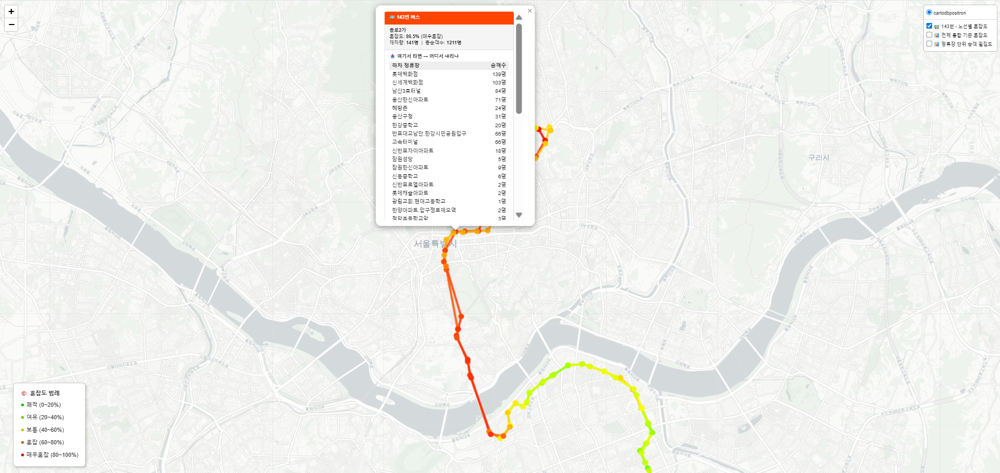
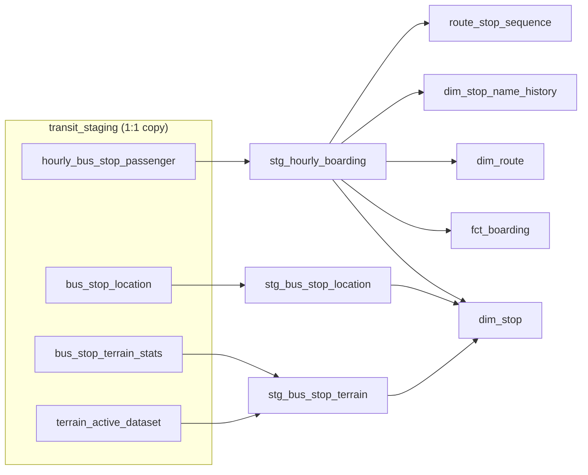
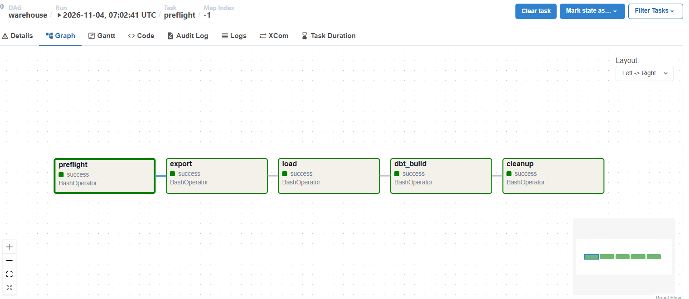

# SeoulTransitPlatform

[](https://github.com/Ianx2933/SeoulTransitPlatform/actions/workflows/ci.yml)

Where, when, and how heavily do people ride transit across the Seoul
metropolitan area — and how far can the source data behind those numbers be
trusted? This platform turns raw smart-card records into stop-, station-, and
district-level demand analysis, with each figure traceable to its source and
method.

It exists because the source data does not answer questions directly. Roughly
10M daily transactions arrive with missing route identifiers, inconsistent stop
codes, and incomplete origin-destination records. The platform reconstructs
usable OD flows from that, validates them, then serves spatial demand queries on
top.

**What it was used to find:** a congested segment that supports a proposal for a
targeted short-turn bus service, a route segment whose demand pattern argues for
splitting it into a local service, three routes carrying over half their demand
on a single core segment, and — after joining terrain data — a dong where 27 of
29 bus stops sit on ground at or above an 8% grade. The service changes are
analysis-based proposals, not implemented changes. See
**[policy insights](docs/analysis/policy_insights.md)**.



## Live demo

**[seoul-transit-prod.web.app](https://seoul-transit-prod.web.app)** — the map
client, served from Firebase Hosting against the deployed API, currently in a
closed beta with external users.

The backend scales to zero, so the first request after an idle period waits for
a cold start. The OD correction endpoints are deliberately locked in the
deployed environment: they mutate data, so they reject every request. Their
contracts are still visible in the OpenAPI document.

## Highlights

| | |
|---|---|
| **Data validation** | Reconciliation checks found a loader overwrite understating monthly boarding by 3.6% and holiday-table errors in six months; fixed, rebuilt on 32 months, and now asserted by tests that surfaced two further holiday omissions — [details](#data-quality-and-validation) |
| **Data correction** | Four-stage OD identifier recovery plus a separate three-stage coordinate matcher with per-row method/confidence provenance |
| **Spatial stack** | PostGIS with GIST, composite, and expression indexes over 1,208 administrative boundaries |
| **Query performance** | District-demand endpoint reduced from ~9.5–12.9 s to sub-second cold calls (best observed 192 ms) with spatial, composite, and expression indexes — [details](#performance-district-demand) |
| **Raster integration** | Terrain attributes from a Copernicus GLO-30 DEM published as immutable versioned snapshots, served per stop and per dong |
| **Demand profiling** | 34 months of hourly boarding read from the warehouse as a labelled 3-D array (34 × 24 × 12,850) and grouped by terrain band, reconciled to the passenger against the source copy |
| **Analytical warehouse** | BigQuery star schema built with dbt from a 1:1 staging copy: 34 months (31.7M rows), 8 models, 25 tests including per-month reconciliation to the source; serving stays in PostGIS — [details](#analytical-warehouse-bigquery-and-dbt) |
| **Cloud pipeline** | Weekly Cloud Scheduler → Workflows → 10 Cloud Run Jobs: loads any newly published month, rebuilds the hourly models into shadow tables, validates them, swaps them in in one transaction and publishes to BigQuery. A full rebuild went from 9 h 30 min to 1 h 31 min with an identical output hash; failed runs send an alert — [details](#weekly-cloud-pipeline) |
| **Orchestration** | Airflow DAG runs a preflight check, export, load and `dbt build` in order; each step is safe to retry, and the export is deleted only after the tests pass — [details](#orchestration) |
| **Backups** | Weekly `pg_dump` to Cloud Storage, checked for readability, required tables and size before upload, with 60-day retention — [details](#backups) |
| **Reproducibility** | Schema scripts + Docker Compose; automated tests use synthetic fixtures; model binaries excluded by design |

## Data quality and validation

Extending the hourly boarding table from six months (2025-01 to 2025-06) to
thirty-two (2024-01 to 2026-08) surfaced four defects that had been producing
plausible numbers. None raised an error. Each was found by reconciling a figure
against something independent of the pipeline that produced it.

- **Loader overwrite.** The source API returns one row per stop *visit*; a route
  passing the same stop twice collided on the table key and the upsert kept only
  one row. 2024-01 boarding was understated by 4,518,304 (3.6%), with row counts
  unaffected. The loader now sums a whole month before writing.
- **Wrong holiday dates.** Day-type counts per month were checked against the
  calendar; six months failed. The calendar is now asserted by tests, which then
  found two further omissions.
- **Fallback ratio summing to 1.105.** Every fallback estimate was inflated by
  10.5%. It is now normalised.
- **All-zero fitted profiles.** 2,327 of 283,353 ratio keys summed to zero, so
  18,965 daily OD passengers on 2025-11-11 reached no hour. Profile selection now
  has three levels, and each row records which one applied.

| Check after rebuild | 32 months, local (Oct 2026) | 34 months, Cloud SQL (Nov 2026) |
|---|---|---|
| Re-loaded months: row counts against the loader log | 24 of 24 match | — |
| Hourly ratio keys summing to exactly 1 or 0 | 283,353 of 283,353 | 285,201 of 285,201 |
| Non-numeric or `00000` ARS codes in derived tables | 0 | 0 |
| Duplicate OD-hour rows across estimation methods | 0 | 0 |
| OD keys in the estimate against the source | 514,499; 0 missing, 0 extra | 514,499; 0 missing, 0 extra |
| Hours per OD key | 24 distinct, no exceptions | 24 distinct, no exceptions |
| Daily passengers conserved per OD key | 0 mismatches at 1e-07 | 0 mismatches at 1e-07 |
| Daily OD passengers not distributed to hours | 0 of 5,345,649 | 0 of 5,345,649 |
| Fallback-profile rows, 2025-11-11 | 243,960 — 181,272 with no key, 62,688 fitted to zeros | 204,888 — 181,272 with no key, 23,616 fitted to zeros |
| SHA-256 over every hourly OD row, across re-runs | identical | identical over the manual rebuild and three workflow runs |

Totals are reconciled per OD key rather than in aggregate, so errors that cancel
out in a 5.3-million sum are still caught. `validate_rebuild.py` runs every check
and exits non-zero, so a rebuild that printed success but left the data wrong
fails the gate instead of the reader.

A fifth defect was found in November 2026, in OD correction rather than the
hourly pipeline. Missing standard stop codes were filled from the T-data stop
API, which ignores its filter and returns the first 1,000 stops of the whole
master. The client took the first item as the answer, so every successful
lookup returned the same Incheon stop (`164000626`), one no Seoul route serves.
Runs on 2023-10-17, 2024-10-19 and 2025-10-14 wrote it into 396 rows: 256
boarding and 144 alighting codes. For later runs the stored key no longer
matched, the API answered 404, and correction quietly fixed nothing. The rows
were copied aside, cleared and refilled from the local stop master, whose node
ID matches the source's standard ID for 10,685 of 10,686 stops. The deployed
Cloud SQL database had been migrated from the local one with the same 396 rows,
so the curated OD API could serve the Incheon code for them until both were
cleaned the same way on 2026-11-04. Correction now uses that table instead of
the API, and a test checks that different stops get different codes.

A sixth defect sat in the same table and was larger. About 1–2% of rows had a
standard code that belonged to a different stop than their ARS number: 0.8% on
2023-10-17 and 2024-10-19, 1.7% on 2025-10-14 and 2.0% on 2025-11-11, the OD
estimation day. OD correction took codes from a reference file by route and
position on the route, without checking that the stop at that position was the
same. On routes that had gained or lost stops since the reference was made,
every later stop took the code of a neighbour a fixed number of places along.
On 2025-10-14, 75% of the wrong codes belonged to another stop on the same route
that day, most often two places along (17 routes) or four (8 routes). The same
wrong route, position and code combinations recur on all four dates, which is
what one reference applied to every date would produce. Correction now looks up
codes in the stop master by ARS first, uses the reference only where the ARS
at that position matches, fills by stop name only rows with no ARS, and fails
if any code disagrees with the master. A test rebuilds a route with one stop
inserted; the old code gives the next stop its neighbour's code and fails it.
In both databases 117,110 rows were copied aside and 71,071 boarding and
85,323 alighting codes rewritten from the master.

The stops that check could not reach held two more cases. Stops outside Seoul are
missing from the Seoul master but present in `integrated_bus_stop_location`;
950,326 of their rows matched it and 2,851 codes were rewritten from it. ARS
`00000` marks a stop with no ARS number, such as a depot. The same-ARS fill
treated it as one stop and copied one depot's code onto about ten others, so
those 10,440 codes were cleared rather than guessed, and correction now treats an
all-zero ARS as missing. The diagnostic and fix queries for these defects are in
[`database/data_fixes/`](database/data_fixes/).

How each defect was found, ruled in, and fixed — including the virtual-stop
filter and the change from an underdetermined to an overdetermined ratio model —
is in **[the hourly pipeline rebuild](docs/analysis/hourly_pipeline_rebuild.md)**.

### What the hourly OD is

The hourly OD tables are an allocation, not an observation. Two separate sources
meet in them: the OD records give origin, destination and passengers for a whole
day with no time of travel (only 2025-11-11 is allocated so far), and the hourly
boarding counts give, for each
stop and hour, how many people boarded over 34 months, but not where they went.
Each daily OD pair is spread over 24 hours in proportion to the day-type hourly
boarding profile of its route at its boarding stop. That assumes every pair
leaving a stop shares the stop's profile; in practice a stop's morning riders and
evening riders head to different places, and the allocation cannot show that.
The checks above prove the allocation is complete and conserves every passenger,
not that its hours match real trips, which would need OD records with boarding
times. More months make the profiles steadier; they do not add OD days.

## Key capabilities

- Node-centered demand lookup around a coordinate radius.
- District-centered demand aggregation by administrative dong.
- Terrain screening by stop and by administrative dong, from published DEM
  snapshots.
- Bus and subway mode filtering.
- Weekday/day-type and hour filtering.
- Route, node, and district-level demand summaries.

## Deployed architecture

Everything runs in `asia-northeast3` (Seoul).

```text
Firebase Hosting ──rewrite /api/**──> Cloud Run: transit-api (public)
  static Vite build                     │
                                        ├──unix socket──> Cloud SQL: PostgreSQL 18 + PostGIS
                                        │                   ▲
                                        │                   │ unix socket
                                        │                   │
                                        │   Cloud Scheduler ──> Workflows: transit-pipeline
                                        │     weekly                 ├─> Cloud Run Job: collector ──> Seoul Open API
                                        │                            ├─> 8 rebuild, validate, publish Jobs (new month only)
                                        │                            └─> Cloud Run Job: warehouse ──> BigQuery + dbt
                                        │
                                        └──ID token─────> Cloud Run: transit-prediction (private)
```

### Decisions worth explaining

**No Memorystore.** The application defaults to Redis, but the deployed service
runs Caffeine (`CACHE_TYPE=caffeine`). Memorystore's smallest instance costs
roughly three times the database, which is the wrong trade for a demo whose
only fixed cost is a `db-f1-micro`. Each Cloud Run instance then holds its own
cache; acceptable at this traffic, and the cache provider is a single
environment variable away from changing.

**The prediction service is not public.** It is deployed with
`--no-allow-unauthenticated`, and `transit-api` attaches a Google-signed ID
token whose audience is the service URL. Model inference is the kind of
endpoint that costs money per call, so it should not be reachable by anyone who
finds the URL.

**No CORS configuration.** Firebase Hosting rewrites `/api/**` to the Cloud Run
service, so the browser only ever sees one origin. The frontend calls relative
paths and needs no build-time API URL.

**Cloud SQL is the source of record, and is sized for serving.** The hourly
table (34 months, 31.7M rows), the OD tables and every model built from them
live in Cloud SQL, and the local database is a development copy. The instance
idles as a `db-f1-micro`. On it the ratio solver needed 7–20 minutes per batch of
50 routes and ran out of memory, so the workflow raises the tier to
`db-custom-2-7680` for the rebuild and lowers it again afterwards, including when
a step fails. The batch tier is billed only for the hours of a rebuild, which
happens when a new month is published.

**Rebuilt tables replace the old ones instead of updating them.** The first cloud
rebuilds upserted into the tables the API reads. That had two costs. The API
served rebuilt figures before validation had run, so a failed check came too late.
And PostgreSQL keeps the old row versions until vacuum frees the space for reuse,
so each table ended up about twice its size: `estimated_hourly_stop_demand` was
1,985 MB in Cloud SQL against 990 MB locally for the same rows, the steps that read
it whole slowed down run after run, and the disk grew by auto-resize from 10 GB to
37 GB, which Cloud SQL cannot shrink. Each rebuilt table is now written from empty
to a `__next` copy, validated there, and swapped in by renaming. The database went
from 20 GB to 16 GB on the first such run, and the disk now has a 45 GB
auto-increase cap so that any further growth fails a run and raises an alert
instead of going unnoticed.

**Browser-facing API without a hosted basemap key.** The map originally used
CartoDB Positron, whose CDN began returning watermark tiles for
unauthenticated requests. The client moved to OpenStreetMap rather than
embedding a CARTO key in a public static bundle.

**Workflows rather than managed Airflow.** The cloud pipeline is ten steps in a
fixed order with one branch (stop if no new month) and one cleanup (scale the
database down). Cloud Workflows covers that and costs next to nothing at one run a week;
Cloud Composer, the managed Airflow option, starts around thirty times the
monthly cost of the database it would be feeding. Airflow stays for local
development, where the DAGs run against the local copy.

**The collector works out which months to load.** Cloud Scheduler sends no
arguments. Called without any, the loader starts after the latest month already
in Cloud SQL and loads each published month up to last month, stopping at the
first one the API reports as not published yet. Publication dates vary (August
2026 data appeared on 3 September, October data was still missing on 4
November), so running weekly and loading whatever has appeared is simpler than
guessing a monthly date. The loader writes the months it loaded to a state file,
and the workflow rebuilds only when that list is not empty.

Deployment environment variables and cache profiles are described in
[`docs/deployment/configuration.md`](docs/deployment/configuration.md).

## Terrain and demand analysis

Bus stop demand is served alongside terrain attributes derived from a Copernicus
GLO-30 DEM by the companion project
[geo-raster-pipeline](https://github.com/Ianx2933/geo-raster-pipeline).

```text
GET /api/stops/accessibility?minSlope=8&limit=100&offset=0
GET /api/stops/accessibility/summary?minSlope=8&minStops=10
GET /api/stops/accessibility/metadata
```

The first returns individual stops at or above a slope threshold, steepest
first. The second aggregates by administrative dong, worst ratio first. The
third reports which snapshot is active and how it was produced.

**Result.** Of 11,480 stops, 4,536 (39.5%) sit on terrain at or above an 8%
grade; the median is 6.51%. Per dong the range is wide — Seonghyeon-dong
(성현동) tops the list with 27 of 29 stops (93.1%), while riverside dongs sit
near zero.

### Versioned snapshots, not columns on the master

Terrain values are not stored on `bus_stop_location`. That table is periodically
reloaded from source CSV, and a derived column written there would be destroyed
by the next reload with no error raised — the API would keep returning 200 while
the values quietly emptied out.

Instead each processing run is published as an immutable snapshot
(`terrain_dataset`, `bus_stop_terrain_stats`, `terrain_stop_dong_assignment`,
and a single-row `terrain_active_dataset` pointer). Publication and activation
are separate steps, so a partially loaded snapshot is never visible, and the
dong-summary cache is keyed by dataset ID with no explicit invalidation.

The stop-to-dong assignment is resolved **once at publication**, not per query.
`ST_Covers` matches a point lying on the shared edge of two polygons, so a
boundary stop would otherwise appear in both dongs and inflate every aggregate.
Interior matches win; remaining ties break deterministically on `adm_cd`; a stop
found strictly inside two polygons aborts the publication, because that means
the boundary layer itself overlaps.

Publishing and activating a snapshot:
[`docs/terrain/publishing.md`](docs/terrain/publishing.md).

### What the numbers mean

This measures terrain gradient across the 30 m DEM cell containing each stop.
It is **not** footway gradient and **not** an accessibility assessment. The
source is a surface model that includes buildings, which inflates values in
dense districts; conversely, 30 m resolution averages away short steep pitches.
Treat it as a screening indicator for narrowing down where to survey.

### An hourly profile in xarray

The boarding source is already three-dimensional — month, hour, stop — so
`pipelines/analysis/demand_xarray.py` loads it as a labelled array rather than a
flat frame, attaches slope as a non-dimension coordinate on the stop axis, and
groups by terrain band. The array total is asserted against the source before
anything is read from it.

It reads from the BigQuery warehouse (`--source bigquery`): demand from
`fct_boarding`, slope from `dim_stop`, and the reconciliation total from the
staging copy of the source, so the check does not read the table it checks.
Reading the serving database instead took hours on its idle tier and lost the
connection from the workstation twice, which is the split the warehouse exists
for. The PostgreSQL path remains, one month per query.

Building the full grid is itself informative. 10.15M source rows expand to
34 × 24 × 12,850 cells, and the gaps are real — a stop with no service at 03:00 is
a missing observation, not a zero. Every aggregate uses `skipna` accordingly. Of
the 12,850 stops, 2,050 have no terrain value, nearly all of them Gyeonggi-do stops
outside the Seoul stop master; they stay in the array and the totals but in no band.

**Result.** Mean boardings per stop-hour, 2024-01 to 2026-10 (34 months, 4.81 billion
boardings reconciled), by slope band. Stops per band: 3,072 / 3,508 / 1,955 / 2,265.

| Hour | 0–4% | 4–8% | 8–12% | 12%+ | 12%+ as share of 0–4% |
| ---- | ---- | ---- | ----- | ---- | --------------------- |
| 04   | 90.5 | 84.6 | 71.2 | 43.0 | **48%** |
| 05   | 191.2 | 185.4 | 178.1 | 125.8 | 66% |
| 07   | 816.6 | 806.7 | 788.3 | 642.4 | 79% |
| 08   | 1014.0 | 1010.1 | 1015.7 | 802.0 | 79% |
| 18   | 1033.5 | 1055.4 | 1110.2 | 849.7 | 82% |
| 22   | 470.6 | 514.3 | 546.7 | 403.0 | 86% |

The steepest band carries roughly 79–86% of flat-ground demand through most of the
day. Between 04:00 and 06:00 that gap roughly doubles, reaching 48% at 04:00. In
the evening the 8–12% band exceeds flat ground outright, and its share of the daily
total peaks higher than any other band (0.084 against 0.080 at 18:00).

The first version of this table used six months loaded before the
[loader fix](#data-quality-and-validation) and left stops on 0% slope out of every
band. With the corrected data and five and a half times the months, every share moved
by one to five points and the shape did not change.

**This is an observation, not a finding.** Slope is confounded with land use here:
steep districts in Seoul are largely residential and flat ground is largely
commercial, so a residential-versus-commercial hourly profile would produce a
similar shape with no terrain effect at all. Separating the two needs a land-use
control the platform does not currently carry. The figure is recorded because it
is a testable question, not because it answers one — the same standing as the
surface-model caveat on the slope values themselves.

## Tech stack

| Layer | Technology |
|---|---|
| Backend API | Spring Boot, Java 21, Maven |
| Database | PostgreSQL, PostGIS |
| Cache | Redis (local), Caffeine (deployed) |
| Prediction service | Python, Flask, XGBoost |
| Frontend | React, Vite, Leaflet (OpenStreetMap basemap) |
| Pipelines | Python, Cloud Workflows, Airflow (local) |
| Multidimensional analysis | xarray, dask, netCDF |
| Raster processing | GDAL/OGR, rasterio (external — [geo-raster-pipeline](https://github.com/Ianx2933/geo-raster-pipeline)) |
| Analytical warehouse | BigQuery, dbt (external — [transit-bigquery](https://github.com/Ianx2933/transit-bigquery)) |
| Local infra | Docker Compose |
| Deployment | Cloud Run (services and jobs), Cloud SQL (PostgreSQL 18 + PostGIS), Cloud Scheduler, Cloud Monitoring, Artifact Registry, Secret Manager, Firebase Hosting |
| Testing | pytest, JUnit 5, Testcontainers/PostGIS, Vitest, GitHub Actions |

## Performance: district-demand

The district-demand endpoint was first measured at 12.9 s and 9.5 s on local
runs. Profiling identified two causes: spatial joins running without GIST
support, and identifier comparisons normalised with `LPAD` that no plain btree
index could serve.

Spatial, composite, and expression indexes plus refreshed table statistics
addressed both. After indexing, a measured call took 490 ms; with the cache
flushed, cold calls stayed under one second, with a best observed cold call of
about 192 ms. These are local measurements on a single development machine —
192 ms is the best observation, not a median or p95.

Because the database path alone became sub-second, the deployed service does
not need a shared cache: it runs Caffeine instead of Redis (see *No
Memorystore*). Production latency on Cloud Run has not yet been measured.

A precomputed node-to-district mapping table was considered and deliberately
not built — indexing was sufficient, and the table would have needed rebuilding
whenever stop locations or boundaries changed.

The terrain integration made the opposite call and precomputed its stop-to-dong
assignment. The reason is not performance but correctness: a boundary stop
matching two polygons inflates every aggregate, and resolving that per query
would mean re-deriving the same tie-break on every request. Precomputation is
acceptable there because the assignment is scoped to an immutable snapshot, so
"needs rebuilding when boundaries change" becomes "a new snapshot is published",
which is the intended workflow rather than a maintenance burden.

Index SQL: `database/performance/district_demand_indexes.sql`
Analysis: [`docs/performance/district_demand_optimization.md`](docs/performance/district_demand_optimization.md)

## Analytical warehouse (BigQuery and dbt)

The serving API reads from PostgreSQL. Analysis runs on a separate BigQuery warehouse built
from the same data. The warehouse code is in [transit-bigquery](https://github.com/Ianx2933/transit-bigquery);
this section summarizes it.

- **Load:** a Python script copies 13 PostgreSQL tables 1:1 into a staging dataset. It writes
  checksums and per-month row and passenger totals at export, then recomputes the monthly
  totals in BigQuery after loading and stops if any month differs.
- **Transform:** dbt builds the dimensional model from staging. 8 models, 25 tests.
- **Data:** 34 months (2024-01 to 2026-10), 31.7M rows of hourly boarding by route and stop,
  exported from Cloud SQL by the [weekly cloud pipeline](#weekly-cloud-pipeline).



### What stayed in PostGIS

BigQuery is columnar and priced by bytes scanned. It has no equivalent of the sub-second
point lookups the serving path depends on, so the split follows the workload rather than the
tables:

| Stays in PostGIS | Moved to BigQuery |
|---|---|
| District-demand and node-catchment endpoints | Hourly boarding facts |
| `ST_Covers` against dong polygons at query time | Aggregations by route, stop and hour |
| GIST-indexed spatial predicates | Terrain statistics joined to stops |
| Anything with a latency target | Ad-hoc analysis |

### Modelling decisions

**No date dimension.** The source key is `(use_ym, route_no, stop_ars, hour)`: a monthly
aggregate by hour with no daily detail. A daily date dimension would suggest observations
that do not exist.

**Integer partitioning on the month.** The warehouse started in the BigQuery sandbox, where
partitions expire 60 days after the partition's own date. A day-partitioned table of 2025
data was empty right after loading, with the job reporting `DONE` and no error. Partitioning
on an integer `YYYYMM` avoids the rule and matches the monthly grain.

**Sandbox settings stay after billing is enabled.** Linking a billing account did not remove
the 60-day expiration already set on the datasets and on each table. By the time this was
checked, the staging tables had been deleted and the warehouse tables were seven days from
deletion. The expirations were cleared per dataset and per table, and staging was reloaded.

**Unmatched stops are kept.** 2,045 of 12,845 stops do not match the Seoul stop master:
2,044 Gyeonggi-do stops on routes that cross the city boundary, and one code (`~`) used for
route terminus markers. They stay in `dim_stop` with a `match_method` column so totals
reconcile against the source and analysts exclude them on purpose.

### Tests

`dbt build` runs the models and tests together. If a test fails, the build stops and the
production dataset is not updated. Builds run as the last step of the weekly cloud pipeline and
of the local `warehouse` Airflow DAG (below).

| Test | Fails when |
|---|---|
| Monthly reconciliation to staging | Any month's row count or passenger totals differ from the source copy |
| Unique fact grain | A (month, route, stop, hour) row appears twice |
| Stop count | `dim_stop` does not hold exactly the distinct stops in the source |
| Referential integrity | A route or stop in the fact table has no dimension row |
| Route type | A route name matches none of the classification rules |

The reconciliation compares totals by month and does not join to the stop table. An earlier
validation query that joined to stops counted some rows twice and overstated boardings by
127,070. At the 32-month reload of October 2026:

| | PostgreSQL | BigQuery |
|---|---|---|
| Rows | 29,855,640 | 29,855,640 |
| Boardings | 4,509,456,552 | 4,509,456,552 |
| Months | 32 | 32 |
| Distinct stops | 12,845 | 12,845 |

### What the modelling found

**Stop names.** Source stop names end with the stop's position on the route, for example
`동묘앞(00029)`. The same stop has a different number on each route that serves it, so 68%
of Seoul stops looked renamed over 32 months. With the number moved to its own column, 14%
(1,468 of 10,800) had real name changes, mostly exit numbers added or developments renamed.
An earlier six-month analysis had reported "1,815 Gyeonggi stops with 2,963 names" for the
same reason; the real figure is 156 of 2,044. Village and city buses also label some stops
differently (`서울숲1번출입구` on 성동13, `서울숲1번출구` on 121).

**Route types.** The 702 routes are classified from their numbers: village 260, branch 220,
trunk 134, commuter 31, custom 28, night 14, express 10, circular 2, autonomous 2, and the
Han River ferry. A trailing A or B marks a variant line of the same route. The source has no
Gyeonggi-registered routes; Gyeonggi stops come from Seoul routes that cross the city
boundary.

### Orchestration

The `warehouse` DAG in `pipelines/airflow/dags/` runs the whole path from the local
PostgreSQL database to the dbt models:



| Task | What it does | On failure |
|---|---|---|
| `preflight` | Connects to PostgreSQL and BigQuery and reports the months found | Stops in seconds instead of partway into an export |
| `export` | Read-only snapshot of 13 tables with checksums and per-month totals | Retried once; the retry deletes its own partial folder |
| `load` | Replaces the staging tables, then reconciles per month | Retried twice; tables already loaded are skipped, and a load job that reached BigQuery is not submitted again |
| `dbt_build` | `dbt build --target prod` | Not retried; a failing test leaves `transit_marts` as it was |
| `cleanup` | Deletes the export folder | Runs only after dbt succeeds, so a failed run's files stay for inspection |

The first full run took about ten minutes. Airflow runs locally in Docker on an image that
adds dbt and the BigQuery client in their own virtualenv, so they cannot change the versions
Airflow depends on. The PostgreSQL password is read inside the task at run time and does not
appear in the commands shown in the Airflow UI.

The DAG is triggered by hand and reads the local database. The scheduled path is the
[weekly cloud pipeline](#weekly-cloud-pipeline), which exports from Cloud SQL instead.

Getting the loader to run unattended meant three changes: it reads the password from the
environment instead of prompting, calls BigQuery through the Python client instead of the `bq`
CLI (which the container does not have), and can replace last month's staging tables instead
of refusing to overwrite them. Its offline tests went from 5 to 16 to cover retries, replace
mode and the missing-password case.

### Weekly cloud pipeline

`ops/workflows/transit_pipeline.yaml`, deployed with `ops/workflows/deploy.ps1`:

| Step | What it does |
|---|---|
| collect | Loads each newly published month and records which months it loaded |
| decide | Ends the run if nothing was loaded, about 20 seconds in total |
| scale up | Cloud SQL `db-f1-micro` → `db-custom-2-7680`, then waits until it accepts connections |
| rebuild | Month-day counts, day-type hourly ratios (route and stop level), OD allocation to hours, stop demand, bus + subway integration, each written to an empty `<table>__next` |
| validate | `validate_rebuild.py` on the `__next` copies; a failed check stops the run with the API and BigQuery unchanged |
| publish | Swaps all five copies in, in one transaction, and gives their indexes back the original names |
| warehouse | Exports from Cloud SQL, replaces the BigQuery staging tables, runs `dbt build --target prod` |
| scale down | Back to `db-f1-micro`, also when any step fails |

A run that ends without success, and a trigger that fails to start one, each send an email
through Cloud Monitoring (`ops/monitoring/`).

**From 9 h 30 min to 1 h 31 min.** Every forced full rebuild produced the same SHA-256 over
all 12,347,976 hourly OD rows, so each change below was checked against the previous output
rather than only for speed.

| Step | 2026-11-07 | Read once | Shadow tables |
|---|---|---|---|
| Ratio solver | 3 h 15 min | 11 min 36 s | 7 min 24 s |
| Stop-pattern solver | 3 h 44 min | 13 min 54 s | 7 min 51 s |
| OD allocation | 39 min | 33 min | 3 min 3 s |
| Stop demand | 19 min | 29 min | 2 min 5 s |
| Bus + subway integration | 23 min | 43 min | 8 min 26 s |
| Validation | 17 min | 40 min | 16 min 51 s |
| Publish | — | — | 45 s |
| Warehouse | 43 min | 29 min | 24 min 53 s |
| **Whole run** | **9 h 30 min** | **3 h 42 min** | **1 h 31 min** |

*Read once.* The solvers queried the 31.7M-row hourly table once per batch of 25 routes, 29
times a run, and each query had to find its routes' rows scattered across every month. They
now stream the table in a few windows of 150 routes, ordered by route, and cut the same
batches from the stream; a check on real data compared both ways batch by batch and found
them identical. A single ordered read of the whole table failed first: its sort needed more
temporary disk than Cloud SQL allows one query (`temp_file_limit`, about 3 GB), so the
windows are sized to stay well under it, and a server limit error now stops the run instead
of being retried.

*Shadow tables.* Writing each rebuilt table from empty with `COPY`, instead of upserting
into a table already holding the previous rebuild, made the write-heavy steps five to ten
times faster, and kept the steps after them from slowing down as the tables bloated (the
middle column).

Steps run one at a time; with two write-heavy jobs at once, both ran several times slower.
Each solver batch commits on its own, and a dropped connection restarts the read at the
first batch not yet written. Timings by step and the prerequisites are in
[`ops/workflows/`](ops/workflows/README.md).

## Backups

In October 2026 the local PostgreSQL data directory disappeared. The cause was not found.
The database was restored from a single full dump that happened to exist from a few weeks
earlier, and the warehouse reload above was taken from that restore.

`ops/backup_pg.ps1` now runs weekly from Windows Task Scheduler:

1. `pg_dump` of the whole database in custom format.
2. Checks before upload: `pg_restore` can read the dump, the core tables are present with
   data, and the file is over a minimum size. A dump that fails any check is not uploaded.
3. Upload to a private Cloud Storage bucket in `asia-northeast3`, then a size comparison
   between the local and uploaded file.
4. Only the newest dump is kept locally. A bucket lifecycle rule deletes objects after 60
   days.

The database password is read from `pgpass.conf` outside the repository.

## Status

| Area | Status |
|---|---|
| Map demand analysis (node-centered and district-centered) | Done |
| District-demand indexing and statistics refresh | Done |
| Terrain snapshots and stop/dong screening API | Done |
| Hourly pipeline rebuild, 2024-01 to 2026-10 | Done, validated; rebuilt in Cloud SQL |
| GCP deployment: serving path | Live, closed beta |
| Weekly cloud pipeline (collect, rebuild, validate, publish) | Running weekly since 2026-11-10; forced full runs passed on 2026-11-07 and 2026-11-08 (1 h 31 min); failure alerts tested |
| BigQuery warehouse | 34 months loaded and modelled in dbt; refreshed by the weekly pipeline |
| Weekly database backup | Running, verified before upload |
| Airflow orchestration | Local development only; correction and warehouse DAGs triggered by hand |

## Quick start

1. **Create the schema** — the API uses `ddl-auto: validate` and will not start
   against an empty database:
   ```bash
   psql -h localhost -U postgres -c "CREATE DATABASE \"Seoul_Transit\" ENCODING 'UTF8';"
   psql -h localhost -U postgres -d Seoul_Transit -f database/schema/run_all.sql
   ```
2. **Start infrastructure** — copy `.env.example` to `.env`, fill in
   `DB_PASSWORD` and `ADMIN_API_TOKEN`, then `docker compose up -d`.
3. **Run the API and frontend** — `mvn spring-boot:run` in
   `services/api-server`, `npm install && npm run dev` in `services/web-client`.

Data loading order, Windows/PowerShell commands, the Redis-free `local-simple`
profile, and smoke tests are in the
[local runbook](docs/deployment/local_runbook.md),
[database setup](docs/deployment/database_setup.md), and
[smoke tests](docs/deployment/smoke_tests.md).

## Tests

Tests are treated as executable engineering contracts rather than a
coverage-number exercise. The highest-value cases lock down fallback
precedence, passenger conservation, provenance, PostGIS boundary semantics
(a stop exactly on a district boundary is counted once), terrain publication
guards, and API input/error contracts. The hourly-pipeline defects above are
covered as contracts on synthetic fixtures; checks against real data live in
`validate_rebuild.py` and run after a rebuild rather than in CI.

```bash
pytest -q                                   # Python pipelines and prediction service
cd services/api-server && ./mvnw test       # Backend, incl. Testcontainers PostGIS/Redis
cd services/web-client && npm ci && npm test  # Frontend
```

CI runs all three layers on every push to `main` and on pull requests. See
[`docs/engineering/testing_strategy.md`](docs/engineering/testing_strategy.md).

## Documentation

| File | Purpose |
|---|---|
| Architecture ([EN](docs/career/en/ARCHITECTURE.md) · [KO](docs/career/ko/ARCHITECTURE.md)) | Current system structure and responsibilities |
| Engineering decisions ([EN](docs/career/en/DECISIONS.md) · [KO](docs/career/ko/DECISIONS.md)) | Why each technology was chosen or changed |
| Engineering results ([EN](docs/career/en/ENGINEERING_RESULTS.md) · [KO](docs/career/ko/ENGINEERING_RESULTS.md)) | Implemented outcomes and their measurement scope |
| Roadmap ([EN](docs/career/en/ROADMAP.md) · [KO](docs/career/ko/ROADMAP.md)) | Priorities toward a wider public beta |
| [`docs/analysis/policy_insights.md`](docs/analysis/policy_insights.md) | Transit policy findings derived from OD analysis |
| [`docs/analysis/hourly_pipeline_rebuild.md`](docs/analysis/hourly_pipeline_rebuild.md) | Full account of the hourly pipeline defects and rebuild |
| [`docs/architecture/overview.md`](docs/architecture/overview.md) | Project background, system design, pipeline |
| [`docs/architecture/map_demand_api.md`](docs/architecture/map_demand_api.md) | Map demand endpoint reference |
| [`docs/architecture/cache_profiles.md`](docs/architecture/cache_profiles.md) | Redis/Caffeine/Testcontainers cache profiles |
| [`docs/architecture/target_architecture.md`](docs/architecture/target_architecture.md) | Domain-oriented package refactoring design |
| [`docs/deployment/configuration.md`](docs/deployment/configuration.md) | Deployment environment variables and cache profiles |
| [`docs/deployment/database_setup.md`](docs/deployment/database_setup.md) | Database creation, schema, and data loading order |
| [`docs/deployment/local_runbook.md`](docs/deployment/local_runbook.md) | Local execution runbook |
| [`docs/deployment/smoke_tests.md`](docs/deployment/smoke_tests.md) | API smoke test commands and expected results |
| [`docs/terrain/INSTALL.md`](docs/terrain/INSTALL.md) | Terrain schema setup and migration order |
| [`docs/terrain/publishing.md`](docs/terrain/publishing.md) | Publishing and activating a terrain snapshot |
| [`docs/terrain/TEST_RESULTS.md`](docs/terrain/TEST_RESULTS.md) | What has and has not been verified |
| [`docs/performance/district_demand_optimization.md`](docs/performance/district_demand_optimization.md) | District-demand performance analysis |
| [`docs/engineering/testing_strategy.md`](docs/engineering/testing_strategy.md) | Test philosophy, invariants, and CI |
| [`docs/changelog/`](docs/changelog/) | Change records and predecessor project artefacts |

## Repository layout

```text
database/schema/        Schema creation scripts, run in numeric order
database/performance/   Performance index scripts
database/terrain/       Terrain snapshot schema, diagnostics, activation
docs/                   Documentation (see table above)
ops/                    Local backup script, bucket lifecycle rule
ops/workflows/          Weekly cloud pipeline (Workflows) and its deploy script
ops/monitoring/         Alert policies for failed pipeline runs and triggers
pipelines/              Python data pipelines by phase
pipelines/airflow/      Airflow DAGs
pipelines/analysis/     xarray demand profiling against terrain bands
pipelines/terrain/      Terrain snapshot publisher and its tests
tests/                  pytest contracts for matching and OD correction
scripts/db/             Data loading helper scripts
services/api-server/    Spring Boot API
services/prediction-service/  Flask prediction service
services/web-client/    React/Vite/Leaflet frontend
.github/workflows/      CI for Python, backend/PostGIS, and frontend tests
firebase.json           Hosting config and the /api/** rewrite to Cloud Run
```

## Data sources, license and security

- Transit data: Seoul Open API (hourly ridership and bus master data).
- Terrain: Copernicus WorldDEM™-30 © DLR e.V. 2010–2014 and © Airbus Defence and
  Space GmbH 2014–2018, under COPERNICUS by the European Union and ESA.
- Administrative boundaries: `admin_dong_boundary`, base date 20250630.
- Basemap: © OpenStreetMap contributors.

Secrets are never committed; `.env.example` holds placeholders only. In the
deployed environment the database credentials and the collector's Seoul Open API key come
from Secret Manager, and each secret is readable only by the service that uses
it. `ADMIN_API_TOKEN` is deliberately left unset in deployment, so the
`/api/od-correction/**` endpoints — which issue UPDATE and DELETE statements —
reject every request rather than depending on a token staying secret.

**Runtime identities.** The API, prediction service, pipeline jobs and the
workflow each run as a dedicated service account with only the access they
need: Cloud SQL for the API and pipeline jobs, their own secrets, `run.invoker` on
the private prediction service for the API. The workflow's account runs the
pipeline jobs, changes the database tier, and is the identity Cloud Scheduler
uses to start the workflow. The prediction service holds no permissions at all. The default
Compute Engine account, which carries `roles/editor`, is not used.

**API keys stay out of logs.** The Seoul Open API takes its key as a URL path
segment, and `requests` copies the full URL into timeout and connection error
messages. The loader and the bus API client re-raise those errors with the key
redacted and without exception chaining, and tests assert that neither the
message nor the traceback contains the key.

## Known gaps

Tracked here so they are visible rather than discovered during deployment.

1. `admin_dong_boundary` has no loader script. The 1,208 administrative units of
   the 2025-06-30 snapshot were imported manually with ogr2ogr and documented in
   `database/schema/04_reference_admin_dong_boundary.sql`, so the data is present
   but the import is not reproducible.
2. `bus_stop_location` and `subway_station_location` have not been compared
   against the live database; the remaining schema files have.
3. Reference CSVs are not committed. Sources and required columns are listed in
   section 4.0 of `docs/deployment/database_setup.md`.
4. Prediction model binaries are intentionally excluded; retraining and expected
   artifact names are documented in `services/prediction-service/README.md`.
5. Terrain snapshots are published manually; there is no scheduled job to
   re-publish when the DEM or the boundary release changes.
6. Temporary, election and substitute holidays are not asserted against an
   external source. A one-off holiday simply absent from the CSV would still pass
   unnoticed.
7. The deployed schema differs from the local one: `pg_dump -t` did not carry the
   terrain guard functions, so the four guard triggers do not exist in Cloud SQL.
   Serving is unaffected because the API only reads those tables.
8. Until November 2026 a key the API did not accept loaded zero rows and exited
   successfully. The loader did check the result code, but only where a
   successful response puts it: inside the service element. Error responses
   (invalid key, no data) return `RESULT` as the document root, so the check
   never ran. This happened in practice when a key was stored with a trailing
   CRLF. The loader now reads `RESULT` from either place and fails on any code
   other than `INFO-000`, except `INFO-200` (month not published yet), which
   ends a scheduled run successfully with nothing loaded. Seven tests cover
   the cases.
9. 0.75% of boarding and alighting stops in `analysis_table_final` (101,864 stop
    rows, 473 ARS numbers) appear in neither stop table, most likely stops that
    have since closed or moved. Their standard codes came from the same
    position-based join as the sixth defect in Data quality and cannot be
    checked. Four ARS numbers outside Seoul map to two nodes and were also left
    as they were.
10. Hourly OD exists for one day, 2025-11-11, and is an allocation of daily OD by
    stop boarding profiles (see [What the hourly OD is](#what-the-hourly-od-is)).
    The weekly pipeline refreshes the profiles with each new month but adds no OD
    days; OD records still arrive by hand through OD correction.

## Next work

1. Carry the terrain guard functions into Cloud SQL, or decide deliberately that
   the cloud database stays read-only for pipeline writes.
2. Extend OD analysis toward trip-chain analysis — transfer patterns and full
   journey flows rather than single-leg boarding and alighting.
3. Re-publish terrain from a bare-earth DTM (Korea's national 5 m 수치표고모델)
   and compare the two snapshots — the versioning scheme exists to make exactly
   that comparison possible.
4. Extend the warehouse with a district dimension, and keep the official route
   type the source API returns (`TRFC_MNS_TYPE_NM`, such as 서울간선버스) to check
   the number-based `route_type` rules against it.
5. Check the stops in Known gap 9 against an archived stop master from the
   year of each OD date.
6. Add OD days: allocate the three other corrected dates (allocation now takes
   minutes), then one representative day a month, and look for OD records that
   carry boarding times to test the allocation against.

See the [Roadmap](docs/career/en/ROADMAP.md) for priorities toward a wider public beta.
