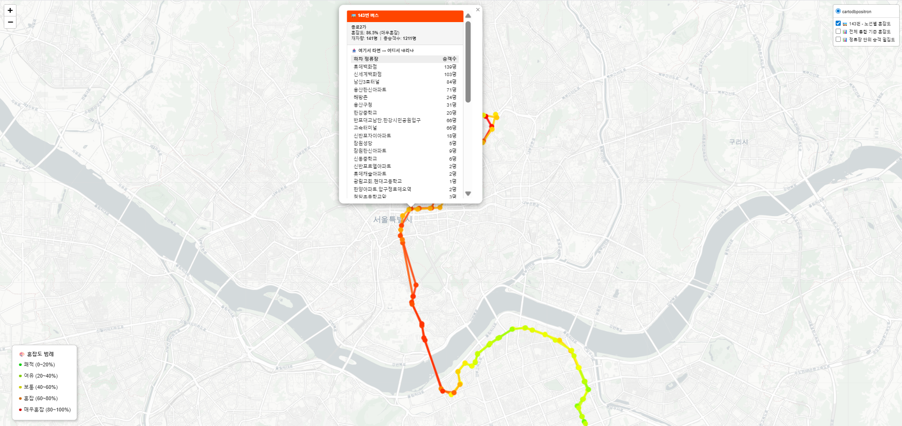

# SeoulTransitPlatform

[](https://github.com/Ianx2933/SeoulTransitPlatform/actions/workflows/ci.yml)

Where, when, and how heavily do people ride transit across the Seoul
metropolitan area — and how far can the source data behind those numbers be
trusted? This platform turns raw smart-card records into stop-, station-, and
district-level demand analysis, with each figure traceable to its source and
method.

It exists because the source data does not answer questions directly. Roughly
10M daily transactions arrive with missing route identifiers, inconsistent stop
codes, and incomplete origin-destination records. The platform reconstructs
usable OD flows from that, validates them, then serves spatial demand queries on
top.

**What it was used to find:** a congested segment that supports a proposal for a
targeted short-turn bus service, a route segment whose demand pattern argues for
splitting it into a local service, three routes carrying over half their demand
on a single core segment, and — after joining terrain data — a dong where 27 of
29 bus stops sit on ground at or above an 8% grade. The service changes are
analysis-based proposals, not implemented changes. See
**[policy insights](docs/analysis/policy_insights.md)**.



## Live demo

**[seoul-transit-prod.web.app](https://seoul-transit-prod.web.app)** — the map
client, served from Firebase Hosting against the deployed API, currently in a
closed beta with external users.

The backend scales to zero, so the first request after an idle period waits for
a cold start. The OD correction endpoints are deliberately locked in the
deployed environment: they mutate data, so they reject every request. Their
contracts are still visible in the OpenAPI document.

## Highlights

| | |
|---|---|
| **Data validation** | Reconciliation checks found a loader overwrite understating monthly boarding by 3.6% and holiday-table errors in six months; fixed, rebuilt on 32 months, and now asserted by tests that surfaced two further holiday omissions — [details](#data-quality-and-validation) |
| **Data correction** | Four-stage OD identifier recovery plus a separate three-stage coordinate matcher with per-row method/confidence provenance |
| **Spatial stack** | PostGIS with GIST, composite, and expression indexes over 1,208 administrative boundaries |
| **Query performance** | District-demand endpoint reduced from ~9.5–12.9 s to sub-second cold calls (best observed 192 ms) with spatial, composite, and expression indexes — [details](#performance-district-demand) |
| **Raster integration** | Terrain attributes from a Copernicus GLO-30 DEM published as immutable versioned snapshots, served per stop and per dong |
| **Demand profiling** | Hourly boarding demand loaded as a labelled 3-D array and grouped by terrain band, reconciled against the SQL source |
| **Analytical warehouse** | Partitioned BigQuery star schema for the analytical half, validated row-for-row against PostGIS on an initial six-month load; serving stays in PostGIS — [transit-bigquery](https://github.com/Ianx2933/transit-bigquery) |
| **Reproducibility** | Schema scripts + Docker Compose; automated tests use synthetic fixtures; model binaries excluded by design |

## Data quality and validation

Extending the hourly boarding table from six months (2025-01 to 2025-06) to
thirty-two (2024-01 to 2026-08) surfaced four defects that had been producing
plausible numbers. None raised an error. Each was found by reconciling a figure
against something independent of the pipeline that produced it.

- **Loader overwrite.** The source API returns one row per stop *visit*; a route
  passing the same stop twice collided on the table key and the upsert kept only
  one row. 2024-01 boarding was understated by 4,518,304 (3.6%), with row counts
  unaffected. The loader now sums a whole month before writing.
- **Wrong holiday dates.** Day-type counts per month were checked against the
  calendar; six months failed. The calendar is now asserted by tests, which then
  found two further omissions.
- **Fallback ratio summing to 1.105.** Every fallback estimate was inflated by
  10.5%. It is now normalised.
- **All-zero fitted profiles.** 2,327 of 283,353 ratio keys summed to zero, so
  18,965 daily OD passengers on 2025-11-11 reached no hour. Profile selection now
  has three levels, and each row records which one applied.

| Check after rebuild | Result |
|---|---|
| Re-loaded months: row counts against the loader log | 24 of 24 match |
| Hourly ratio keys summing to exactly 1 or 0 | 283,353 of 283,353 |
| Non-numeric or `00000` ARS codes in derived tables | 0 |
| Duplicate OD-hour rows across estimation methods | 0 |
| OD keys in the estimate against the source | 514,499; 0 missing, 0 extra |
| Hours per OD key | 24 distinct, no exceptions |
| Daily passengers conserved per OD key | 0 mismatches at 1e-07 |
| Daily OD passengers not distributed to hours | 0 of 5,345,649 |
| Fallback-profile rows, 2025-11-11 | 243,960 — 181,272 with no key, 62,688 fitted to zeros |
| Estimator re-run: row count and SHA-256 over every row | identical |

Totals are reconciled per OD key rather than in aggregate, so errors that cancel
out in a 5.3-million sum are still caught. `validate_rebuild.py` runs every check
and exits non-zero, so a rebuild that printed success but left the data wrong
fails the gate instead of the reader.

How each defect was found, ruled in, and fixed — including the virtual-stop
filter and the change from an underdetermined to an overdetermined ratio model —
is in **[the hourly pipeline rebuild](docs/analysis/hourly_pipeline_rebuild.md)**.

## Key capabilities

- Node-centered demand lookup around a coordinate radius.
- District-centered demand aggregation by administrative dong.
- Terrain screening by stop and by administrative dong, from published DEM
  snapshots.
- Bus and subway mode filtering.
- Weekday/day-type and hour filtering.
- Route, node, and district-level demand summaries.

## Deployed architecture

Everything runs in `asia-northeast3` (Seoul).

```text
Firebase Hosting ──rewrite /api/**──> Cloud Run: transit-api (public)
  static Vite build                     │
                                        ├──unix socket──> Cloud SQL: PostgreSQL 18 + PostGIS
                                        │                   ▲
                                        │                   │ unix socket
                                        │                   │
                                        │   Cloud Scheduler ──> Cloud Run Jobs: transit-collector
                                        │     monthly              └──> Seoul Open API
                                        │
                                        └──ID token─────> Cloud Run: transit-prediction (private)
```

### Decisions worth explaining

**No Memorystore.** The application defaults to Redis, but the deployed service
runs Caffeine (`CACHE_TYPE=caffeine`). Memorystore's smallest instance costs
roughly three times the database, which is the wrong trade for a demo whose
only fixed cost is a `db-f1-micro`. Each Cloud Run instance then holds its own
cache; acceptable at this traffic, and the cache provider is a single
environment variable away from changing.

**The prediction service is not public.** It is deployed with
`--no-allow-unauthenticated`, and `transit-api` attaches a Google-signed ID
token whose audience is the service URL. Model inference is the kind of
endpoint that costs money per call, so it should not be reachable by anyone who
finds the URL.

**No CORS configuration.** Firebase Hosting rewrites `/api/**` to the Cloud Run
service, so the browser only ever sees one origin. The frontend calls relative
paths and needs no build-time API URL.

**Pipeline intermediates stay out of the cloud database.** Five tables holding
OD estimates and day-of-week ratio models are transform outputs the API never
reads, so they were left behind; loading only what the serving path queries
keeps the instance inside its 10 GB disk. The hourly passenger table is the
exception — it was created empty in Cloud SQL rather than copied, because the
scheduled job rebuilds it a month at a time from the source API.

**Browser-facing API without a hosted basemap key.** The map originally used
CartoDB Positron, whose CDN began returning watermark tiles for
unauthenticated requests. The client moved to OpenStreetMap rather than
embedding a CARTO key in a public static bundle.

**Cloud Scheduler rather than managed Airflow.** Three of the ten pipeline
modules call external APIs, but only one runs in the cloud: the monthly
hourly-ridership loader, a single step with no dependencies — Cloud Run Jobs on
a monthly trigger covers it. Airflow earns its keep on the local DAG, where
ingestion, OD correction, hourly estimation and aggregation depend on each other
in order. Cloud Composer, the managed option, starts around thirty times the
monthly cost of the database it would be feeding.

**The scheduled job computes its own month.** Cloud Scheduler sends no
arguments, and writing the month into the trigger would mean editing the
trigger every month. The loader defaults to the previous month when called
with no arguments; because the upsert is idempotent, a month that was already
loaded is simply rewritten with the same values.

Deployment environment variables and cache profiles are described in
[`docs/deployment/configuration.md`](docs/deployment/configuration.md).

## Terrain and demand analysis

Bus stop demand is served alongside terrain attributes derived from a Copernicus
GLO-30 DEM by the companion project
[geo-raster-pipeline](https://github.com/Ianx2933/geo-raster-pipeline).

```text
GET /api/stops/accessibility?minSlope=8&limit=100&offset=0
GET /api/stops/accessibility/summary?minSlope=8&minStops=10
GET /api/stops/accessibility/metadata
```

The first returns individual stops at or above a slope threshold, steepest
first. The second aggregates by administrative dong, worst ratio first. The
third reports which snapshot is active and how it was produced.

**Result.** Of 11,480 stops, 4,536 (39.5%) sit on terrain at or above an 8%
grade; the median is 6.51%. Per dong the range is wide — Seonghyeon-dong
(성현동) tops the list with 27 of 29 stops (93.1%), while riverside dongs sit
near zero.

### Versioned snapshots, not columns on the master

Terrain values are not stored on `bus_stop_location`. That table is periodically
reloaded from source CSV, and a derived column written there would be destroyed
by the next reload with no error raised — the API would keep returning 200 while
the values quietly emptied out.

Instead each processing run is published as an immutable snapshot
(`terrain_dataset`, `bus_stop_terrain_stats`, `terrain_stop_dong_assignment`,
and a single-row `terrain_active_dataset` pointer). Publication and activation
are separate steps, so a partially loaded snapshot is never visible, and the
dong-summary cache is keyed by dataset ID with no explicit invalidation.

The stop-to-dong assignment is resolved **once at publication**, not per query.
`ST_Covers` matches a point lying on the shared edge of two polygons, so a
boundary stop would otherwise appear in both dongs and inflate every aggregate.
Interior matches win; remaining ties break deterministically on `adm_cd`; a stop
found strictly inside two polygons aborts the publication, because that means
the boundary layer itself overlaps.

Publishing and activating a snapshot:
[`docs/terrain/publishing.md`](docs/terrain/publishing.md).

### What the numbers mean

This measures terrain gradient across the 30 m DEM cell containing each stop.
It is **not** footway gradient and **not** an accessibility assessment. The
source is a surface model that includes buildings, which inflates values in
dense districts; conversely, 30 m resolution averages away short steep pitches.
Treat it as a screening indicator for narrowing down where to survey.

### An hourly profile in xarray

The boarding source is already three-dimensional — month, hour, stop — so
`pipelines/analysis/demand_xarray.py` loads it as a labelled array rather than a
flat frame, attaches slope as a non-dimension coordinate on the stop axis, and
groups by terrain band. The array total is asserted against the PostgreSQL sum
before anything is read from it.

Building the full grid is itself informative. 1.79M source rows expand to
6 × 24 × 12,529 cells, and the gaps are real — a stop with no service at 03:00 is
a missing observation, not a zero. Every aggregate uses `skipna` accordingly.

**Result.** Mean boardings per stop-hour, 2025-01 to 2025-06, by slope band.
These figures predate the [loader fix](#data-quality-and-validation) and will
shift when re-run; stops visited twice per trip were the most understated.

| Hour | 0–4% | 4–8% | 8–12% | 12%+ | 12%+ as share of 0–4% |
| ---- | ---- | ---- | ----- | ---- | --------------------- |
| 04   | 85.6 | 79.1 | 66.9  | 37.2 | **43%** |
| 05   | 178.9 | 172.5 | 164.2 | 113.8 | 64% |
| 07   | 773.4 | 758.3 | 742.6 | 601.8 | 78% |
| 08   | 963.7 | 951.9 | 960.2 | 756.3 | 78% |
| 18   | 981.4 | 992.6 | 1054.4 | 796.5 | 81% |
| 22   | 451.8 | 490.6 | 521.5 | 379.0 | 84% |

The steepest band carries roughly 78–84% of flat-ground demand through most of the
day. Between 04:00 and 06:00 that gap roughly doubles, reaching 43% at 04:00. In
the evening the 8–12% band exceeds flat ground outright, and its share of the daily
total peaks higher than any other band (0.084 against 0.080 at 18:00).

**This is an observation, not a finding.** Slope is confounded with land use here:
steep districts in Seoul are largely residential and flat ground is largely
commercial, so a residential-versus-commercial hourly profile would produce a
similar shape with no terrain effect at all. Separating the two needs a land-use
control the platform does not currently carry. The figure is recorded because it
is a testable question, not because it answers one — the same standing as the
surface-model caveat on the slope values themselves.

## Tech stack

| Layer | Technology |
|---|---|
| Backend API | Spring Boot, Java 21, Maven |
| Database | PostgreSQL, PostGIS |
| Cache | Redis (local), Caffeine (deployed) |
| Prediction service | Python, Flask, XGBoost |
| Frontend | React, Vite, Leaflet (OpenStreetMap basemap) |
| Pipelines | Python, Airflow |
| Multidimensional analysis | xarray, dask, netCDF |
| Raster processing | GDAL/OGR, rasterio (external — [geo-raster-pipeline](https://github.com/Ianx2933/geo-raster-pipeline)) |
| Analytical warehouse | BigQuery (external — [transit-bigquery](https://github.com/Ianx2933/transit-bigquery)) |
| Local infra | Docker Compose |
| Deployment | Cloud Run, Cloud SQL (PostgreSQL 18 + PostGIS), Artifact Registry, Secret Manager, Firebase Hosting |
| Testing | pytest, JUnit 5, Testcontainers/PostGIS, Vitest, GitHub Actions |

## Performance: district-demand

The district-demand endpoint was first measured at 12.9 s and 9.5 s on local
runs. Profiling identified two causes: spatial joins running without GIST
support, and identifier comparisons normalised with `LPAD` that no plain btree
index could serve.

Spatial, composite, and expression indexes plus refreshed table statistics
addressed both. After indexing, a measured call took 490 ms; with the cache
flushed, cold calls stayed under one second, with a best observed cold call of
about 192 ms. These are local measurements on a single development machine —
192 ms is the best observation, not a median or p95.

Because the database path alone became sub-second, the deployed service does
not need a shared cache: it runs Caffeine instead of Redis (see *No
Memorystore*). Production latency on Cloud Run has not yet been measured.

A precomputed node-to-district mapping table was considered and deliberately
not built — indexing was sufficient, and the table would have needed rebuilding
whenever stop locations or boundaries changed.

The terrain integration made the opposite call and precomputed its stop-to-dong
assignment. The reason is not performance but correctness: a boundary stop
matching two polygons inflates every aggregate, and resolving that per query
would mean re-deriving the same tie-break on every request. Precomputation is
acceptable there because the assignment is scoped to an immutable snapshot, so
"needs rebuilding when boundaries change" becomes "a new snapshot is published",
which is the intended workflow rather than a maintenance burden.

Index SQL: `database/performance/district_demand_indexes.sql`
Analysis: [`docs/performance/district_demand_optimization.md`](docs/performance/district_demand_optimization.md)

## Analytical warehouse: what moved to BigQuery

The analytical half of the platform has a BigQuery counterpart: a partitioned,
clustered star schema in
[transit-bigquery](https://github.com/Ianx2933/transit-bigquery). The current
load covers six months (2025-01 to 2025-06) and was reconciled row-for-row
against PostGIS, but it predates the [loader fix](#data-quality-and-validation);
reloading the rebuilt 32 months is the next step.

The serving endpoints stayed here. BigQuery is columnar and scan-priced, with no
concept of a sub-second point lookup — the sub-second district-demand path above
is a serving concern, and moving it would have undone the indexing work it
depends on.
So the split is by workload, not by table:

| Stays in PostGIS | Moved to BigQuery |
|---|---|
| District-demand and node-catchment endpoints | Hourly boarding facts |
| `ST_Covers` against dong polygons at query time | Aggregations by route, stop, hour |
| GIST-indexed spatial predicates | Terrain statistics joined to stops |
| Anything with a latency budget | Ad-hoc analyst queries |

**No date dimension.** The warehoused source has primary key
`(use_ym, route_no, stop_ars, hour)` — a monthly hourly aggregate with no
day-level detail. A dense date dimension would imply observations that do not
exist.

**Integer partitioning, not date.** Day-partitioned historical data expires on
arrival under the sandbox's non-negotiable 60-day partition expiry, which is
measured from the partition's own date rather than from load time. The load job
reports `DONE`, the table holds zero rows, and no error is raised anywhere. This
is the same class of silent-emptying failure the terrain snapshots were designed
around.

**Unmatched stops kept, not dropped.** 1,816 of 12,529 stops do not resolve
against the Seoul stop master — Gyeonggi-do stops on cross-boundary routes, plus
route terminus markers. They are carried with a `match_method` column, the same
per-row provenance discipline the four-stage OD recovery already uses here, so
aggregate totals reconcile against the source and analysts exclude them
explicitly rather than inheriting a silently filtered universe.

## Status

| Area | Status |
|---|---|
| Map demand analysis (node-centered and district-centered) | Done |
| District-demand indexing and statistics refresh | Done |
| Terrain snapshots and stop/dong screening API | Done |
| Hourly pipeline rebuild, 2024-01 to 2026-08 | Done, validated |
| GCP deployment: serving path and monthly ingestion | Live, closed beta |
| BigQuery star schema | Built; six-month pre-fix load, 32-month reload pending |
| Airflow orchestration | Correction DAG running locally; remaining modules by hand |

## Quick start

1. **Create the schema** — the API uses `ddl-auto: validate` and will not start
   against an empty database:
   ```bash
   psql -h localhost -U postgres -c "CREATE DATABASE \"Seoul_Transit\" ENCODING 'UTF8';"
   psql -h localhost -U postgres -d Seoul_Transit -f database/schema/run_all.sql
   ```
2. **Start infrastructure** — copy `.env.example` to `.env`, fill in
   `DB_PASSWORD` and `ADMIN_API_TOKEN`, then `docker compose up -d`.
3. **Run the API and frontend** — `mvn spring-boot:run` in
   `services/api-server`, `npm install && npm run dev` in `services/web-client`.

Data loading order, Windows/PowerShell commands, the Redis-free `local-simple`
profile, and smoke tests are in the
[local runbook](docs/deployment/local_runbook.md),
[database setup](docs/deployment/database_setup.md), and
[smoke tests](docs/deployment/smoke_tests.md).

## Tests

Tests are treated as executable engineering contracts rather than a
coverage-number exercise. The highest-value cases lock down fallback
precedence, passenger conservation, provenance, PostGIS boundary semantics
(a stop exactly on a district boundary is counted once), terrain publication
guards, and API input/error contracts. The hourly-pipeline defects above are
covered as contracts on synthetic fixtures; checks against real data live in
`validate_rebuild.py` and run after a rebuild rather than in CI.

```bash
pytest -q                                   # Python pipelines and prediction service
cd services/api-server && ./mvnw test       # Backend, incl. Testcontainers PostGIS/Redis
cd services/web-client && npm ci && npm test  # Frontend
```

CI runs all three layers on every push to `main` and on pull requests. See
[`docs/engineering/testing_strategy.md`](docs/engineering/testing_strategy.md).

## Documentation

| File | Purpose |
|---|---|
| Architecture ([EN](docs/career/en/ARCHITECTURE.md) · [KO](docs/career/ko/ARCHITECTURE.md)) | Current system structure and responsibilities |
| Engineering decisions ([EN](docs/career/en/DECISIONS.md) · [KO](docs/career/ko/DECISIONS.md)) | Why each technology was chosen or changed |
| Engineering results ([EN](docs/career/en/ENGINEERING_RESULTS.md) · [KO](docs/career/ko/ENGINEERING_RESULTS.md)) | Implemented outcomes and their measurement scope |
| Roadmap ([EN](docs/career/en/ROADMAP.md) · [KO](docs/career/ko/ROADMAP.md)) | Priorities toward a wider public beta |
| [`docs/analysis/policy_insights.md`](docs/analysis/policy_insights.md) | Transit policy findings derived from OD analysis |
| [`docs/analysis/hourly_pipeline_rebuild.md`](docs/analysis/hourly_pipeline_rebuild.md) | Full account of the hourly pipeline defects and rebuild |
| [`docs/architecture/overview.md`](docs/architecture/overview.md) | Project background, system design, pipeline |
| [`docs/architecture/map_demand_api.md`](docs/architecture/map_demand_api.md) | Map demand endpoint reference |
| [`docs/architecture/cache_profiles.md`](docs/architecture/cache_profiles.md) | Redis/Caffeine/Testcontainers cache profiles |
| [`docs/architecture/target_architecture.md`](docs/architecture/target_architecture.md) | Domain-oriented package refactoring design |
| [`docs/deployment/configuration.md`](docs/deployment/configuration.md) | Deployment environment variables and cache profiles |
| [`docs/deployment/database_setup.md`](docs/deployment/database_setup.md) | Database creation, schema, and data loading order |
| [`docs/deployment/local_runbook.md`](docs/deployment/local_runbook.md) | Local execution runbook |
| [`docs/deployment/smoke_tests.md`](docs/deployment/smoke_tests.md) | API smoke test commands and expected results |
| [`docs/terrain/INSTALL.md`](docs/terrain/INSTALL.md) | Terrain schema setup and migration order |
| [`docs/terrain/publishing.md`](docs/terrain/publishing.md) | Publishing and activating a terrain snapshot |
| [`docs/terrain/TEST_RESULTS.md`](docs/terrain/TEST_RESULTS.md) | What has and has not been verified |
| [`docs/performance/district_demand_optimization.md`](docs/performance/district_demand_optimization.md) | District-demand performance analysis |
| [`docs/engineering/testing_strategy.md`](docs/engineering/testing_strategy.md) | Test philosophy, invariants, and CI |
| [`docs/changelog/`](docs/changelog/) | Change records and predecessor project artefacts |

## Repository layout

```text
database/schema/        Schema creation scripts, run in numeric order
database/performance/   Performance index scripts
database/terrain/       Terrain snapshot schema, diagnostics, activation
docs/                   Documentation (see table above)
pipelines/              Python data pipelines by phase
pipelines/airflow/      Airflow DAGs
pipelines/analysis/     xarray demand profiling against terrain bands
pipelines/terrain/      Terrain snapshot publisher and its tests
tests/                  pytest contracts for matching and OD correction
scripts/db/             Data loading helper scripts
services/api-server/    Spring Boot API
services/prediction-service/  Flask prediction service
services/web-client/    React/Vite/Leaflet frontend
.github/workflows/      CI for Python, backend/PostGIS, and frontend tests
firebase.json           Hosting config and the /api/** rewrite to Cloud Run
```

## Data sources, license and security

- Transit data: Seoul Open API (hourly ridership and bus master data).
- Terrain: Copernicus WorldDEM™-30 © DLR e.V. 2010–2014 and © Airbus Defence and
  Space GmbH 2014–2018, under COPERNICUS by the European Union and ESA.
- Administrative boundaries: `admin_dong_boundary`, base date 20250630.
- Basemap: © OpenStreetMap contributors.

Secrets are never committed; `.env.example` holds placeholders only. In the
deployed environment the database credentials and both Seoul Open API keys come
from Secret Manager, and each secret is readable only by the service that uses
it. `ADMIN_API_TOKEN` is deliberately left unset in deployment, so the
`/api/od-correction/**` endpoints — which issue UPDATE and DELETE statements —
reject every request rather than depending on a token staying secret.

**Runtime identities.** The API, prediction service, collector job and its
scheduler each run as a dedicated service account with only the access they
need: Cloud SQL for the API and collector, their own secrets, `run.invoker` on
the private prediction service for the API, and on the collector job for the
scheduler. The prediction service holds no permissions at all. The default
Compute Engine account, which carries `roles/editor`, is not used.

**API keys stay out of logs.** The Seoul Open API takes its key as a URL path
segment, and `requests` copies the full URL into timeout and connection error
messages. The loader and the bus API client re-raise those errors with the key
redacted and without exception chaining, and tests assert that neither the
message nor the traceback contains the key.

## Known gaps

Tracked here so they are visible rather than discovered during deployment.

1. `admin_dong_boundary` has no loader script. The 1,208 administrative units of
   the 2025-06-30 snapshot were imported manually with ogr2ogr and documented in
   `database/schema/04_reference_admin_dong_boundary.sql`, so the data is present
   but the import is not reproducible.
2. `bus_stop_location` and `subway_station_location` have not been compared
   against the live database; the remaining schema files have.
3. Reference CSVs are not committed. Sources and required columns are listed in
   section 4.0 of `docs/deployment/database_setup.md`.
4. Prediction model binaries are intentionally excluded; retraining and expected
   artifact names are documented in `services/prediction-service/README.md`.
5. Terrain snapshots are published manually; there is no scheduled job to
   re-publish when the DEM or the boundary release changes.
6. Outputs derived from the hourly table before the rebuild have not been
   regenerated: the BigQuery warehouse load and the xarray terrain profile above.
   Both predate the loader fix, so their totals are understated.
7. Temporary, election and substitute holidays are not asserted against an
   external source. A one-off holiday simply absent from the CSV would still pass
   unnoticed.
8. The deployed schema differs from the local one: `pg_dump -t` did not carry the
   terrain guard functions, so the four guard triggers do not exist in Cloud SQL.
   Serving is unaffected because the API only reads those tables.
9. A key the API does not accept does not fail: the service answers with an
   empty result, so the loader reports zero rows and exits successfully. This
   happened in practice when a key was stored with a trailing CRLF; keys are now
   stripped on load, but a wrong key or a month not yet published still passes
   silently. Two separate Seoul Open API keys are in use, which makes the first
   case easy to hit.

## Next work

1. Reload the rebuilt 32 months into BigQuery and re-run the xarray terrain
   profile on corrected data.
2. Move the remaining pipeline modules behind Airflow; only the correction DAG
   is migrated so far.
3. Carry the terrain guard functions into Cloud SQL, or decide deliberately that
   the cloud database stays read-only for pipeline writes.
4. Extend OD analysis toward trip-chain analysis — transfer patterns and full
   journey flows rather than single-leg boarding and alighting.
5. Re-publish terrain from a bare-earth DTM (Korea's national 5 m 수치표고모델)
   and compare the two snapshots — the versioning scheme exists to make exactly
   that comparison possible.
6. Extend the warehouse — district dimension, Airflow orchestration of the load,
   and a Type 2 decision for stop renames: the 1,815 Gyeonggi stops carry 2,963
   distinct names.
7. Treat a zero-row load as a failure for months old enough to have been
   published, so an invalid key cannot pass as a successful run.

See the [Roadmap](docs/career/en/ROADMAP.md) for priorities toward a wider public beta.
