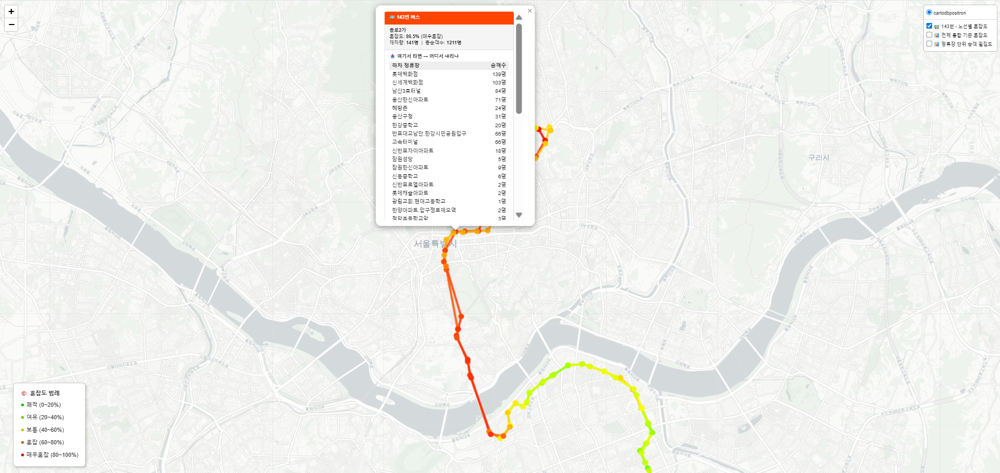
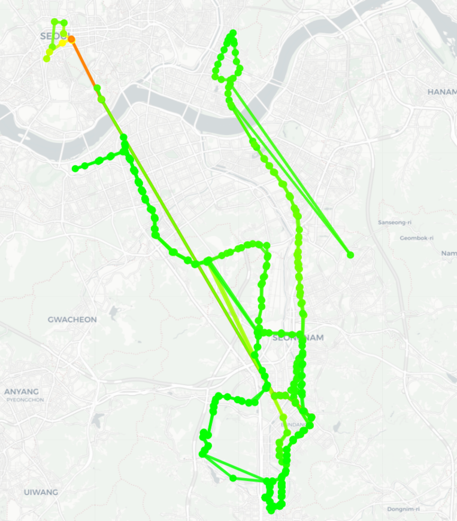
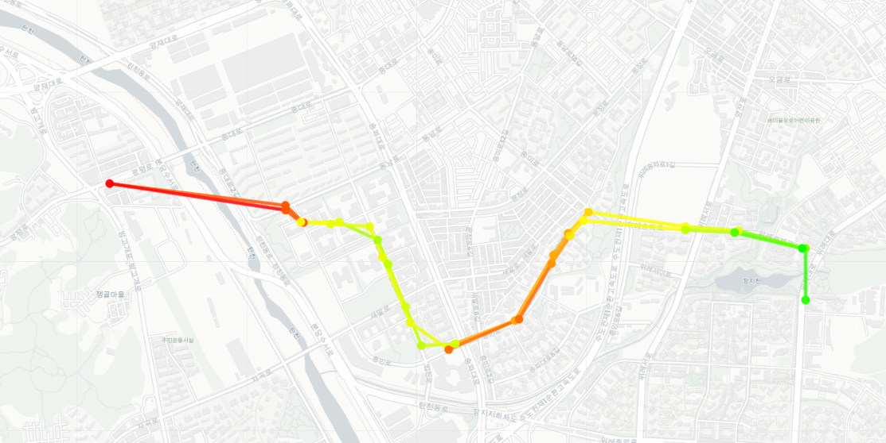
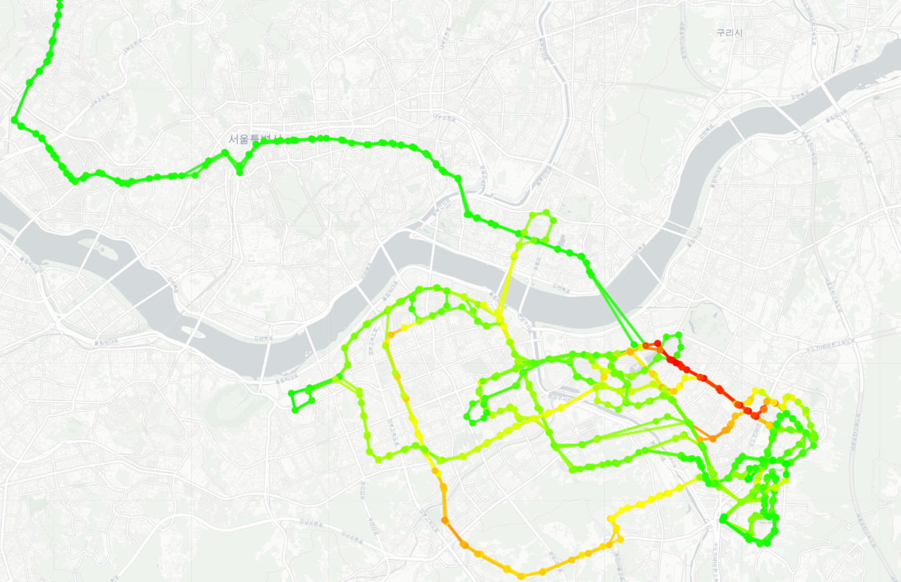
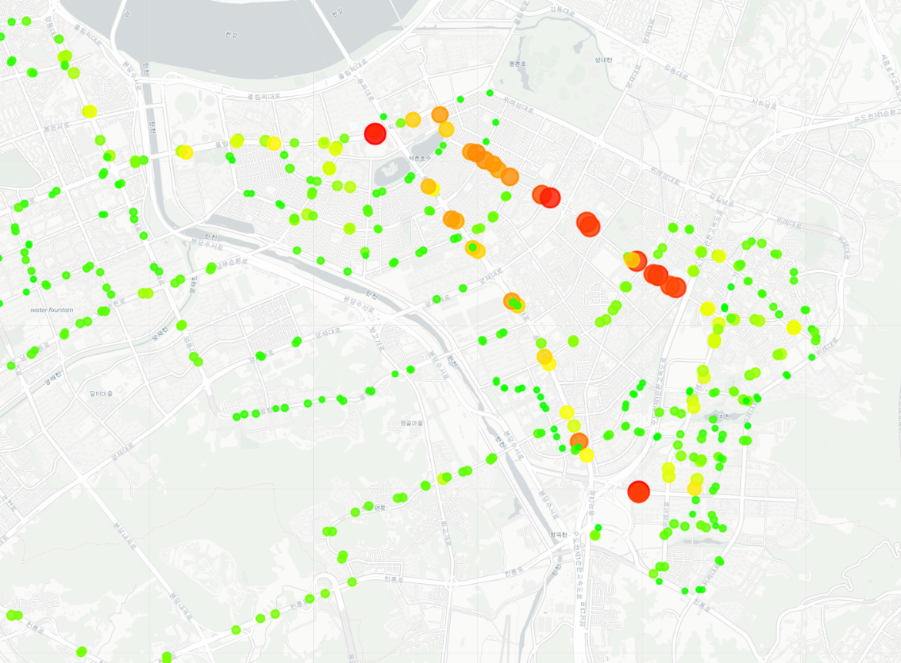
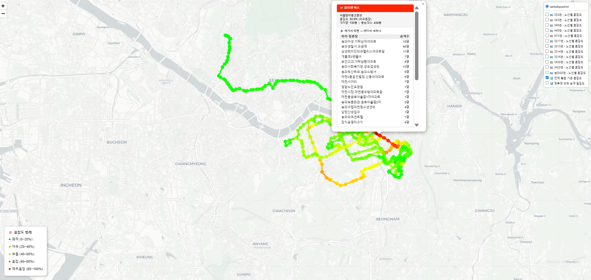

# Policy Insights from OD Analysis

Findings from Seoul and Gyeonggi bus origin-destination data that translate
into concrete transit policy recommendations.

These results come from the analysis phase that preceded this platform. The
platform exists to make this kind of analysis repeatable rather than one-off.

## Method

| Step | Approach |
|---|---|
| Data | Bus smart card OD records, corrected through the four-stage pipeline |
| Congestion metric | Cumulative onboard passengers per segment, normalized to vehicle capacity |
| Segmentation | Filtered by route, stop sequence, and direction |
| Validation | Cross-checked against known complaint patterns and existing service |
| Typical-day recomputation | Mean daily OD over the typical weekdays of the last twelve months (`transit_marts.od_typical_route_stop_serving`), rebuilt with [`pipelines/analysis/policy_insights_typical.py`](../../pipelines/analysis/policy_insights_typical.py) |

The original analysis does not record which day its numbers come from. Each
section below keeps the original figures and adds the typical-weekday
recomputation next to them. Typical-weekday figures are passengers per day, not
per hour or per bus.

Congestion grades used throughout:

| Grade | Load factor | Colour |
|---|---|---|
| Comfortable | 0–20% | Green |
| Light | 20–40% | Light green |
| Moderate | 40–60% | Yellow |
| Crowded | 60–80% | Orange |
| Severely crowded | 80–100% | Red |

---

## 1. Route 143 — case for targeted short-turn service

Segment: Jongno 2-ga → Express Bus Terminal (종로2가 – 고속터미널)

The segment registers as severely crowded across the full length of route 143,
and it is a segment with a known history of passenger complaints.

**Findings**

- Highest load factor of any segment on route 143.
- Standard full-size buses alone do not cover peak demand on this stretch.
- Demand is concentrated in commuting hours rather than spread across the day.

**Typical-weekday recomputation**

On daily totals the Jongno 2-ga → Express Bus Terminal segment is not the
highest-load segment of route 143. The highest daily on-board counts are
Jeongneung Gireum Market → Miari Pass (정릉길음시장 → 미아리고개, 3,637 a day)
and Banpo Bridge south → Hangang Middle School (3,538), followed by the
Yongsan-gu Office stretch. The original finding was about peak-hour load
factor, which daily totals cannot confirm or refute; a peak-hour recomputation
is still to be done before this recommendation is restated.

**Recommendation**

Introduce a *daramjwi* bus — a short-turn service that runs only the congested
segment at concentrated headways during peak hours — rather than increasing
frequency across the entire route. This targets capacity where the load is
without adding vehicle-hours on segments that are already comfortable.

---

## 2. Routes 302 / 303 — case for splitting a segment into a local service

Routes 302 and 303 share most of their alignment but diverge between
Sangdaewon depot and Seongho Market (상대원차고지 ~ 성호시장). Alighting demand
on that non-overlapping segment was analysed to determine whether it serves
Seoul-bound trips or local Seongnam trips.

**Alighting passengers by stop**

| Stop | Sequence | Alighting |
|---|---:|---:|
| Seongnam Medical Center / Sinheung 1-dong Center | 19 | **390** |
| Seongnam Sports Complex / Seongnam-dong Center | 15 | 191 |
| Seongil Middle-High School | 16 | 161 |
| Jungang Market | 21 | 139 |
| Seongho Market Entrance | 18 | 132 |
| Jungwon-gu Office | 14 | 74 |
| Daeha Elementary / Jungwon Youth Center | 10 | 60 |
| Artenville Rear Gate | 11 | 48 |

Typical-weekday recomputation (route 302, sequences 10–21): Seongnam Medical
Center 376, Jungang Market 216, Seongnam Sports Complex 187, Seongil
Middle-High School 177. The ranking of the top stops is reproduced; Jungang
Market is higher than in the original table. Route 303 on the same sequences
is dominated by Dandae-ogeori Station (단대오거리역, 784 a day), a Line 8
transfer that route 302 does not serve.

**Threshold used**

Korean transit agencies and academic practice treat a transfer volume above
**50 passengers** at a single point as the level at which service complaints
can no longer be handled case by case — it becomes a structural service
question.

**Findings**

- Demand concentrates in the top three stops, all of which are Seongnam civic
  and institutional destinations rather than Seoul-bound transfer points.
- Demand drops sharply after Jungang Market (sequence 21).
- The pattern indicates a Seongnam local travel market, not a Seoul commuting
  market.

**Recommendation**

Operate the Sangdaewon depot → Jungang Market segment as a Gyeonggi local bus
service, separate from the Seoul-bound trunk route. Truncating route 302 at
Bokjeong Station and running Bokjeong ↔ Sangwangsimni would raise operating
efficiency relative to the current alignment.

---

## 3. Demand concentration — quantifying the case for route restructuring

OD records were filtered by segment to measure what share of each route's total
demand falls on its core segment.

**Routes 303 and 302**

| Route | Segment | Passengers | Share of route total | Typical weekday | Share |
|---|---|---:|---:|---:|---:|
| 303 | Sangdaewon ↔ Jamsil Stn (both directions) | 14,319 | **56.3%** | 14,156 | **56.0%** |
| 303 | Sangdaewon ↔ Statistics Korea / Taepyeong Stn | 4,939 | 19.4% | 5,168 | 20.4% |
| 302 | Sangdaewon ↔ Jamsil Stn (both directions) | 9,559 | **51.2%** | 9,240 | **49.1%** |
| 302 | Sangdaewon ↔ Statistics Korea / Taepyeong Stn | 3,404 | 18.2% | 3,552 | 18.9% |

**Route 4425**

| Route | Segment | Passengers | Share of route total | Typical weekday | Share |
|---|---|---:|---:|---:|---:|
| 4425 | Sangdaewon ↔ Bokjeong Stn | 2,264 | 28.6% | 1,945 | 24.1% |
| 4425 | Eungok Village ↔ Samseong Stn (both directions) | 4,457 | **56.3%** | 4,456 | **55.3%** |

**Route 452 (typical weekday only)**

Route 452 runs from Bokjeong Station transfer centre (복정역환승센터) through
Wirye, Namhansanseong and central Seongnam to Gangnam and Chung-Ang
University, and back. Its typical-day stop list has no Songpa depot stop, so
the Bokjeong end is the transfer centre.

| Route | Segment | Typical weekday | Share of route total |
|---|---|---:|---:|
| 452 | Bokjeong Stn transfer centre ↔ Dandae-ogeori | 2,806 | 14.2% |
| 452 | Sanseong Stn (Korea Polytechnic) ↔ Taepyeong Stn | 4,157 | 21.0% |
| 452 | Sanseong Stn (Korea Polytechnic) ↔ Bokjeong-dong Center | 6,050 | 30.5% |

**Findings**

The core-segment shares are reproduced on the typical weekday to within about
two percentage points, except route 4425 Sangdaewon ↔ Bokjeong (24.1% against
28.6%). All three routes carry about half or more of their demand on a single
core segment.
This cuts two ways, and both are actionable:

- The core segment justifies added frequency on evidence rather than on
  complaint volume.
- The remaining segments carry demand thin enough that restructuring or
  truncation can be argued from the same dataset.

---

## 4. Demand crossing the segment end (typical weekday)

For each candidate segment, riders who board inside it and alight past its
far end B (Seoul-bound leg). These are the riders a truncation at B would
force to transfer. Candidate ends: Taepyeong Station, the buffer stop ARS
48028 (Seongnam Medical Center, Seoul-bound side only), and Bokjeong.
"From seq" is the stop from which more than 25 / 50 / 100 crossing riders a
day are on board, counting boardings from the segment start.

| Route | Segment (A → B) | Within | Crossing B | Crossing share of route | >25 from seq | >50 from seq | >100 from seq |
|---|---|---:|---:|---:|---:|---:|---:|
| 302 | Sangdaewon → Taepyeong Stn | 1,893 | 1,083 | 5.7% | 6 | 9 | 11 |
| 302 | Sangdaewon → buffer 48028 | 1,281 | 1,113 | 5.9% | 4 | 6 | 9 |
| 302 | Sangdaewon → Bokjeong | 2,483 | 1,506 | 8.0% | 7 | 10 | 13 |
| 303 | Sangdaewon → Taepyeong Stn | 2,802 | 1,659 | 6.6% | 3 | 4 | 7 |
| 303 | Sangdaewon → buffer 48028 | 1,827 | 1,672 | 6.6% | 2 | 3 | 4 |
| 303 | Sangdaewon → Bokjeong | 3,677 | 2,434 | 9.6% | 4 | 6 | 8 |
| 4425 | Sangdaewon → Taepyeong Stn | 796 | 430 | 5.3% | 7 | 9 | 11 |
| 4425 | Sangdaewon → buffer 48028 | 508 | 478 | 5.9% | 5 | 7 | 9 |
| 4425 | Sangdaewon → Bokjeong | 1,047 | 525 | 6.5% | 8 | 11 | 13 |
| 452 | Bokjeong transfer centre → Dandae-ogeori | 1,406 | 1,313 | 6.6% | 3 | 5 | 8 |
| 452 | Sanseong Stn → Taepyeong Stn | 2,026 | 1,405 | 7.1% | 8 | 9 | 10 |
| 452 | Sanseong Stn → buffer 48028 | 1,269 | 1,532 | 7.7% | 8 | 8 | 9 |
| 452 | Sanseong Stn → Bokjeong-dong Center | 3,106 | 1,538 | 7.8% | 8 | 10 | 12 |

**Findings**

- Whichever end is chosen, crossing demand is 5–10% of the route total per
  direction, and more than 100 crossing riders a day are on board within the
  first 4–13 stops of the segment. No candidate end isolates a self-contained
  local market.
- The buffer stop is the weakest cut: crossing demand is about as large as the
  demand within the segment (452: larger). Most of it is one to three stops
  long — Seongnam Medical Center → Jungang Market / Taepyeong Station is the
  largest single pair on routes 302, 303 and 452 (85–128 a day).
- Taepyeong Station gives the best within-to-crossing ratio of the three
  ends.

---

## 5. How far each stop's load carries (typical weekday)

For a stop, take the riders on board as the bus leaves it (all boardings up to
the stop minus all alightings up to it) and follow them forward: the table
gives the farthest stop up to which more than 200 / 100 / 50 / 25 of them are
still on board. Seoul-bound leg.

| Route | Stop (seq) | On board | >200 until | >100 until | >50 until | >25 until |
|---|---|---:|---|---|---|---|
| 302 | Sangdaewon 1-dong (7) | 474 | Jungwon-gu Office (14) | Seongho Market (17) | Sujeong Saemaeul (20) | Bokjeong Elem. (29) |
| 302 | Jungwon-gu Office (14) | 1,050 | Jungang Market (21) | Bokjeong-dong (30) | Munjeong Rodeo (35) | Seokchon Lake (39) |
| 302 | Seongnam Medical Center (19) | 1,113 | Jangji Stn (33) | Songpa Stn (37) | Seokchon Lake (39) | Guui 3-dong (46) |
| 302 | Taepyeong Stn (22) | 1,083 | Garak Market (36) | Seokchon Lake (39) | Dong-Seoul Post (44) | Children's Grand Park (51) |
| 303 | Sangdaewon 1-dong (7) | 1,275 | Sujeong Saemaeul (15) | Sujinri Pass (19) | Munjeong Court (29) | Jamsil Stn (35) |
| 303 | Sangdaewon Pass (10) | 1,896 | Sujinri Pass (19) | Jangji Stn (28) | Seokchon Lake (34) | Junggok-dong (45) |
| 303 | Seongnam Medical Center (14) | 1,672 | Songpa Stn (32) | Jayang-dong (38) | Cheongnyeon Hoeuiso (49) | Dongbu Hospital (53) |
| 303 | Gachon Univ. Stn (20) | 2,317 | Guui 2-dong (43) | Dapsimni (50) | Dongbu Hospital (53) | Dongbu Hospital (53) |
| 4425 | Sangdaewon 1-dong (7) | 333 | Sangdaewon Pass (10) | Sinheung Stn (13) | Sujeong Saemaeul (15) | Sujinri Pass (19) |
| 4425 | Dandae-ogeori (11) | 413 | Seongnam Medical Center (14) | Sujeong Police (18) | Segok Sports Park (29) | Hyosung Harrington (33) |
| 4425 | Seongnam Medical Center (14) | 478 | Sujeong Police (18) | Gwangyeon Driving School (28) | Hyosung Harrington (33) | Jaenggol (39) |
| 452 | Bokjeong transfer centre (1) | 310 | Minsok Village (6) | Namhansanseong Park (8) | Eulji Univ. (10) | Namhansanseong Stn (13) |
| 452 | Eulji Univ. (10) | 913 | Seongnam Medical Center (19) | Sujeong Police (23) | Eungok Village (35) | Maljukgeori Park (47) |
| 452 | Dandae-ogeori (16) | 1,313 | Saem Village (40) | Maeheon Forest (45) | Raemian (50) | Banpo Stn (55) |
| 452 | Seongnam Medical Center (19) | 1,551 | KOTRA (44) | Banbang Junction (49) | Nonhyeon Stn (54) | Banpo Stn (55) |

**Findings**

- Load picked up in the Sangdaewon hills mostly stays in Seongnam: from
  Sangdaewon Pass on route 303 more than 200 a day ride only as far as Sujinri
  Pass, and route 4425 falls below 200 right after Dandae-ogeori. Routes 303
  and 4425 work as feeders to Dandae-ogeori (Line 8) on this stretch — 784 of
  route 303's riders alight there each weekday.
- Load picked up in central Seongnam (Seongnam Medical Center to Taepyeong)
  goes deep into Seoul: more than 200 a day ride on to Jangji (302), Songpa
  (303) or KOTRA (452). A cut at the buffer stop or at Taepyeong Station
  falls on exactly these riders; on route 302 more than 200 a day are still on
  board from Taepyeong Station as far as Garak Market.
- On route 452 the Bokjeong–Wirye end is a separate local market: riders
  boarding at Bokjeong transfer centre fall below 25 at Namhansanseong
  Station, and hardly any cross Dandae-ogeori. Its Namhansanseong stretch
  feeds Namhansanseong Station (Line 8) in both directions.
- Route 303 carries the longest Seoul-bound load: from Gachon University
  more than 200 a day ride on to Guui-dong.

**Caveat.** On the terminus-bound leg the same measure always runs to the
stop before the terminus at the lower levels, because the riders bound for
the terminus stay on board to the end. Only the >200 level separates stops
there (route 302 from Taepyeong Station to Hadaewon-dong, 303 to
Sangdaewon 1-dong, 452 to Sangwon Elementary). Excluding terminus alightings
would make that leg comparable.

---

## Supporting visualisations

### Network-wide congestion

Congestion across all analysed routes, graded green through red by segment
load factor.

### Songpa 02 — directional asymmetry

A community shuttle route showing congestion concentrated in specific
segments, with load differing by direction of travel. Asymmetric patterns like
this matter for scheduling: capacity added in both directions would be wasted
on the lighter one.

### Wirye district — corridor versus interior

Routes serving Wirye New Town. Load rises along the Ogeum-ro corridor toward
Geoyeo and Jamsil, while demand inside the new town itself stays low — a
pattern that argues against adding interior circulation before the corridor is
addressed.

### Wirye district — stop-level density

Total onboard passengers per stop across all routes, sized and coloured by
volume. This view surfaces transfer hubs and primary destinations that
route-by-route views obscure.

### OD inspection interface

Clicking a stop shows its OD breakdown; the layer panel toggles routes
independently. This per-stop OD view is the entry point for trip-chain
analysis.

---

## Extension: trip-chain analysis

OD analysis is the first stage of trip-chain analysis. The current results
describe boarding and alighting patterns for a single route on a single day.
The same data supports:

| Direction | What it would show |
|---|---|
| Time-of-day analysis | Peak versus midday patterns — the basis for flexible headway policy |
| Transfer patterns | Which stops and which route pairs generate the most transfers |
| Individual journey flows | Full origin-to-destination paths as a single trip rather than separate legs |
| Restricted-access data | Transfer patterns and rider-type raw data, available only through Korea's data safe zone under privacy law |

The platform in this repository implements the first of these: hourly demand by
stop, station, and administrative district. See
[`docs/architecture/overview.md`](../architecture/overview.md).

---

## Related work

A separate project for Yongin City applied the same approach — spatial data as
the basis for a policy recommendation — to river and urban planning. It
combined drone photogrammetry (Pix4D with custom OpenCV feature matching for
segments the commercial pipeline could not resolve), a game-engine digital twin
placing the resulting 3D mesh in city context, and spatial analysis of resident
survey responses to identify preferred public space. The proposal received a
city award.

That work is not published here: its code and data are owned by the
municipality and carry security restrictions.
