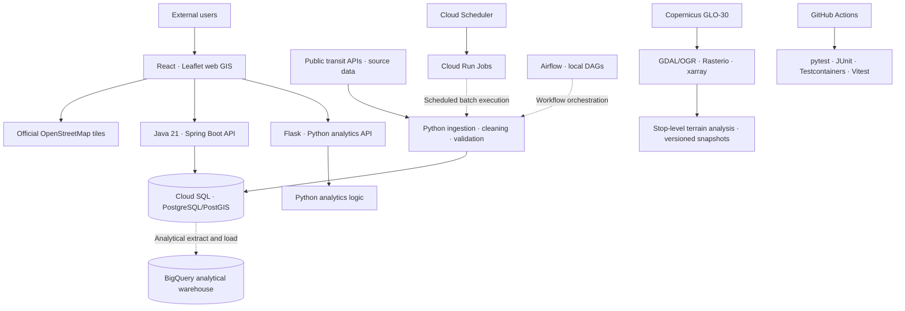

# SeoulTransitPlatform — Architecture

> As of October 2026 · **Closed Beta (with external users)**  
> This document describes the current responsibilities and connections among system components. Planned extensions are tracked in the [Roadmap](ROADMAP.md).

## 1. System responsibilities

SeoulTransitPlatform is a public-facing transit data product that collects, cleans, corrects, and analyzes transit data for the Seoul metropolitan area. External users can explore transit demand through a map and APIs. A central design principle is to distinguish **observations, corrections, estimates, and forecasts**, including their provenance.

- **SeoulTransitPlatform:** Transit-data ingestion and cleaning, OD processing, service APIs, web GIS, and deployment on Google Cloud.
- **transit-bigquery:** Initial BigQuery analytical warehouse with a star-schema foundation, aggregation models, and an initial six-month dataset.
- **geo-raster-pipeline:** DEM-based stop-level elevation and slope analysis, with versioned terrain snapshots.

Repositories are separated by responsibility, while users access the product through the SeoulTransitPlatform website.

## 2. Logical architecture

> **Logical diagram:** Highlights major service responsibilities and data flows. The frontend uses Firebase Hosting, service APIs run on Cloud Run, and Airflow DAGs currently execute locally.

## 3. Languages and service boundaries

| Component | Responsibility | Selection rationale |
|---|---|---|
| Python | Ingestion, cleaning, analytics, and raster processing | Existing proficiency and the data-processing ecosystem |
| Java 21 + Spring Boot | Service backend APIs | Established backend ecosystem, I/O-heavy workloads, potential use of Virtual Threads, and LTS support horizon |
| Flask | Expose Python analytics through HTTP APIs | Allow React/JavaScript to call Python analytics without duplicating the logic in Java |
| JavaScript + React | Web UI, filters, and map interaction | Browser compatibility and previous experience |
| Vite | React development server and production build | Frontend development and deployment tooling |

Java 21 was chosen with I/O-bound concurrency and long-term support in mind. Virtual Threads can help concurrency efficiency; they do **not** make an individual slow database query execute faster.

## 4. Storage and processing boundaries

| Layer | Technology | Purpose and current scope |
|---|---|---|
| Service storage and spatial queries | PostgreSQL/PostGIS (Cloud SQL) | Spatial SQL, stop-to-neighborhood mapping, API queries |
| Analytical warehouse | BigQuery | Broad scans and aggregations over long periods and OD data; initial six-month load and foundational models |
| File-based storage and exchange | Parquet + PyArrow | Efficient storage/reuse of large transit datasets and Python-based I/O |
| Partitioned processing | Dask | Manage memory pressure when processing large datasets |
| Multidimensional processing | xarray | Arrays with named dimensions, including spatial dimensions |
| Spatial-data conversion | GDAL/OGR | Raster/vector conversion and processing |
| Python raster analysis | Rasterio | Reading and analyzing raster data in Python |
| Elevation source | Copernicus GLO-30 DEM | Elevation data originally needed for contour work and subsequently used for stop-level elevation/slope analysis |

### Core data principles

1. Do not present observed, corrected, estimated, and forecast values as if they have identical meanings.
2. Make a metric's period, release version, source, administrative boundaries/stop assignment versions, and methodology traceable.
3. Aim to make API, warehouse, and downloadable aggregates reproducible under consistent definitions.
4. Evolve data validation and release management so corrected figures can be published safely; see the [Roadmap](ROADMAP.md).

## 5. Mapping, caching, and cloud operations

- **Leaflet:** Displays geospatial analysis results; the current application does not need massive map-object rendering and has not encountered a map-interaction performance problem.
- **Basemap:** Switched from the CARTO tile service being used to official OpenStreetMap tiles when that CARTO offering became paid. Operate in accordance with the official tile-service policy and attribution requirements.
- **Query performance and caching:** Spatial, composite, and expression indexes reduced the `district-demand` endpoint from roughly 9.5–12.9 s to sub-second cold calls locally. Redis caches repeated requests in local execution; because the indexed database path is already sub-second, the cloud deployment uses an in-process **Caffeine** cache instead of a paid shared Redis instance.
- **Cloud Run:** Selected from the outset for serverless container hosting; **Cloud SQL:** managed PostgreSQL/PostGIS; **Firebase Hosting:** React web hosting.
- **Cloud Scheduler + Cloud Run Jobs:** Run the monthly hourly-ridership loader, a single cloud step with no dependencies. **Airflow:** Three of the ten pipeline modules call external APIs; Airflow orchestrates the dependent local chain (ingestion → OD correction → hourly estimation → aggregation), with the correction DAG migrated so far. Deployment and scheduling consolidation are tracked in the [Roadmap](ROADMAP.md).
- **Secret Manager:** Manages operational secrets; **Google Cloud Billing budget alerts:** already configured.

## 6. Development quality and CI

Git and GitHub provide source version control. On pushes and pull requests, GitHub Actions automatically runs **pytest (Python), JUnit (Java), Testcontainers (container-based integration tests), and Vitest (JavaScript/React)**. Docker supports container-based execution, deployment, and integration testing.

## 7. Operational scope and next steps

The current **Closed Beta** serves the transit-data APIs and web GIS to external users. BigQuery contains a foundational analytical warehouse, while Airflow currently runs local DAGs. Document generation, research-oriented downloads, and a full data-mart refresh remain planned work; see the [Roadmap](ROADMAP.md).

---

For technology choices and changes, see [Engineering Decisions](DECISIONS.md). For implementation outcomes, see [Engineering Results](ENGINEERING_RESULTS.md).
