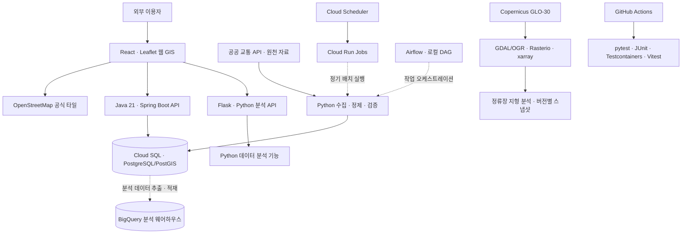

# SeoulTransitPlatform — Architecture

> 기준: 2026년 10월 · **Closed Beta (외부 이용자 있음)**  
> 현재 시스템의 책임과 연결 구조를 설명한다. 향후 확장 작업은 [ROADMAP](ROADMAP.md)에 정리했다.

## 1. 시스템의 책임

SeoulTransitPlatform은 수도권 교통 원천 데이터를 수집·정제·보정·분석하고, 외부 이용자가 지도와 API로 교통 수요를 조회할 수 있도록 하는 공개형 교통 데이터 제품이다. 데이터의 **측정·보정·추정·예측** 단계와 출처를 구분하는 것을 원칙으로 한다.

- **SeoulTransitPlatform:** 교통 데이터 수집·정제·OD 처리, 서비스 API, 웹 GIS, GCP 배포.
- **transit-bigquery:** 교통 데이터를 분석용으로 적재하는 BigQuery 기반 기초 웨어하우스. Star Schema 및 집계 모델과 초기 6개월 적재 범위를 갖춘다.
- **geo-raster-pipeline:** DEM 기반 정류장 고도·경사 분석 및 버전별 지형 스냅샷.

저장소는 역할에 따라 분리하되 외부 이용자의 접근 지점은 SeoulTransitPlatform 웹사이트로 통합한다.

## 2. 논리 구성

> **논리 구성도:** 사용자 기능과 데이터 처리의 주요 역할을 표현한 그림이다. 프런트엔드는 Firebase Hosting, 서비스 백엔드는 Cloud Run 기반으로 운영한다. Airflow DAG는 현재 로컬에서 실행한다.

## 3. 언어와 서비스 경계

| 구성 | 책임 | 선택의 배경 |
|---|---|---|
| Python | 데이터 수집·정제·분석 및 래스터 처리 | 개발 숙련도와 데이터 처리 생태계 |
| Java 21 + Spring Boot | 서비스 백엔드 API | 성숙한 서버 개발 생태계, I/O 중심의 웹서비스, Virtual Threads 활용 가능성 및 LTS 지원 기간 |
| Flask | Python 분석 기능을 웹에 연결하는 API | Python 분석 로직을 Java로 중복 구현하지 않고 React/JS에서 호출 |
| JavaScript + React | 웹 UI, 분석 조건·지도 상호작용 | 웹 환경 적합성·기존 사용 경험 |
| Vite | React 개발 서버·프로덕션 빌드 | 프런트엔드 개발 및 배포용 빌드 구성 |

Java 21은 I/O 대기가 많은 서버의 동시성 대응 가능성과 LTS 지원 기간을 고려한 선택이다. Virtual Threads는 개별 데이터베이스 쿼리를 직접 가속하는 기술과 구분한다.

## 4. 저장소와 데이터 처리 경계

| 계층 | 기술 | 목적·현재 상태 |
|---|---|---|
| 서비스 저장·공간조회 | PostgreSQL/PostGIS (Cloud SQL) | 공간 SQL, 정류장·행정동 매핑, 서비스 API 조회 |
| 분석 웨어하우스 | BigQuery | 광범위한 기간·OD 스캔/집계; 초기 6개월 데이터 및 기초 분석 모델 적재 |
| 파일 저장·교환 | Parquet + PyArrow | 대량 교통 데이터 효율적 저장·재사용 및 Python 입출력 |
| 분할 처리 | Dask | 메모리 부담을 고려한 대량 데이터 처리 |
| 다차원 처리 | xarray | 공간 차원을 포함한 다차원 배열 처리 |
| 지리 데이터 변환 | GDAL/OGR | 래스터·벡터 변환 및 처리 |
| Python 래스터 분석 | Rasterio | 래스터 읽기·분석 |
| 지형 원천 | Copernicus GLO-30 DEM | 등고선용 고도 자료, 이후 정류장별 고도·경사 분석에도 활용 |

### 핵심 데이터 원칙

1. 원천 관측값과 보정·추정·예측 결과를 같은 의미의 숫자로 혼합하지 않는다.
2. 지표마다 기준 기간, 데이터 버전, 출처, 행정동 경계/정류장 배정 버전과 분석 방법을 확인할 수 있게 한다.
3. 공개 API와 웨어하우스/다운로드의 집계가 동일한 기준으로 재현되도록 한다.
4. 검증과 데이터 릴리스 관리를 통해 변경된 수치를 안전하게 공개하는 체계를 발전시킨다([ROADMAP](ROADMAP.md) 참조).

## 5. 지도·캐시·클라우드 운영

- **Leaflet:** 분석 결과의 지도 표출. 대량 지도 객체 렌더링이 요구되지 않고, 현재 상호작용 성능 문제도 보고되지 않았다.
- **배경지도:** CARTO의 이용 서비스가 유료로 전환되어 OpenStreetMap 공식 타일 서버로 변경. 공식 타일의 출처 표시 및 이용 정책을 준수하도록 운영한다.
- **조회 성능과 캐시:** 공간·복합·표현식 인덱스로 `district-demand` API를 로컬 기준 약 9.5~12.9초에서 1초 미만의 cold 호출로 개선했다. Redis는 로컬 실행에서 반복 요청을 캐시한다. 인덱스 적용 후 DB 경로만으로 1초 미만이 되었으므로, 클라우드에서는 유료 공유 Redis 대신 애플리케이션 내장 **Caffeine** 캐시를 사용한다.
- **Cloud Run:** 서버리스 컨테이너 환경을 사용하려는 계획에 따라 선택; **Cloud SQL:** PostgreSQL/PostGIS 운영; **Firebase Hosting:** React 웹 호스팅.
- **Cloud Scheduler + Cloud Run Jobs:** 의존성이 없는 단일 작업인 월별 시간대 승하차 로더를 클라우드에서 실행한다. **Airflow:** 10개 파이프라인 모듈 중 외부 API를 호출하는 모듈은 3개이며, Airflow는 로컬에서 서로 의존하는 처리 체인(수집 → OD 보정 → 시간대 추정 → 집계)을 관리한다. 현재 보정 DAG까지 이전했다. 배포와 스케줄 통합은 [ROADMAP](ROADMAP.md)에 정리했다.
- **Secret Manager:** 운영 비밀정보 관리; **GCP 예산 알림:** 설정 완료.

## 6. 개발 품질과 CI

Git/GitHub로 소스코드 형상관리를 수행한다. GitHub Actions에서는 Push 및 Pull Request에 따라 **pytest(Python), JUnit(Java), Testcontainers(컨테이너 통합 테스트), Vitest(JavaScript/React)**를 자동 실행한다. Docker는 컨테이너 실행 환경, 배포 및 통합 테스트에 활용한다.

## 7. 운영 범위와 다음 단계

현재 운영 중인 기능은 교통 데이터 조회 API와 웹 GIS 중심의 **Closed Beta**이다. BigQuery는 기초 분석 웨어하우스, Airflow는 로컬 DAG 구성 단계이며, 보고서 생성·연구용 다운로드와 전체 데이터 마트 확대는 향후 작업이다. 구체적인 순서는 [ROADMAP](ROADMAP.md)에 정리했다.

---

기술 선정·변경 근거는 [DECISIONS](DECISIONS.md), 구현 성과는 [ENGINEERING_RESULTS](ENGINEERING_RESULTS.md)를 참조한다.
